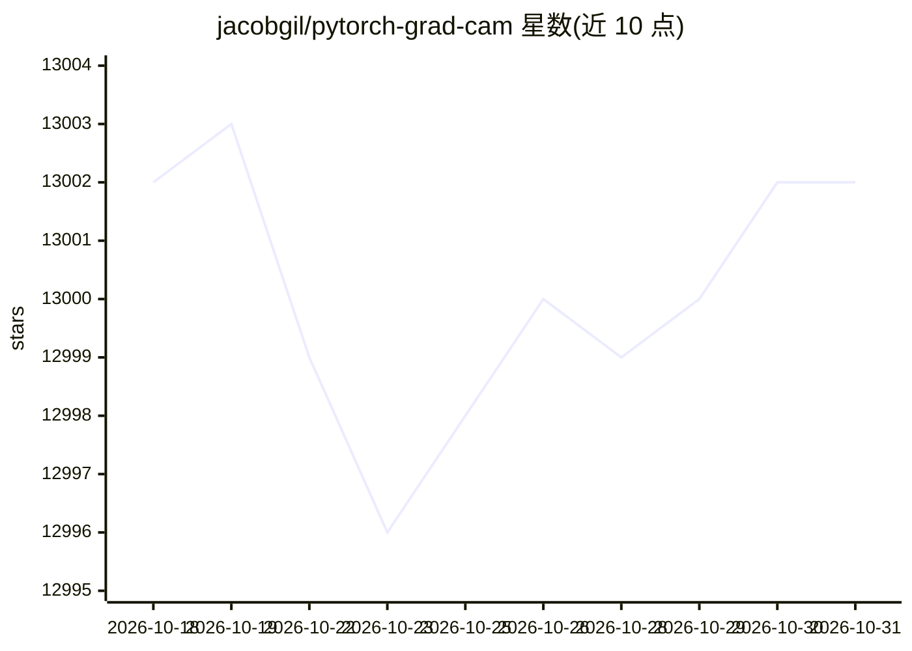

# jacobgil/pytorch-grad-cam

⭐ 13,002 · Python · MIT · 推送 2026-08-13 · [GitHub](https://github.com/jacobgil/pytorch-grad-cam) · [官网](https://jacobgil.github.io/pytorch-gradcam-book) · 个人维护

**PyTorch 计算机视觉可解释性库：多类 CAM 方法与评测指标**

面向 PyTorch 模型的像素归因（CAM 类）可解释性工具包，收录 GradCAM、HiResCAM、ScoreCAM、EigenCAM 等 18 种方法，支持分类、目标检测、语义分割（含 3D 医学分割）、嵌入相似度与 CLIP 文本提示解释，兼容 CNN 与 Vision Transformer。提供 reshape_transform 与 model_target 机制适配非标准架构，含解释可信度评测指标与两种平滑手段（aug/eigen smoothing）及 SESS 多尺度滑窗包装器。pip 安装，支持批处理图像，可用 cpu/cuda/mps/hpu 设备。

## 筛选速览

| 维度 | 判定 | 备注 |
|---|---|---|
| AI 角色 | `ai-ecosystem` | LLM/agent 周边工具 |
| 许可风险 | `permissive` | MIT |
| 部署形态 | `library` | 以包/库形式分发 |
| 模型依赖 | — | README 未给出锁定关系 |
| 硬件要求 | — | 无带数字的原话,不猜 |
| 安装摩擦 | `medium` | 含编译或系统依赖之一 |
| 成熟度 | — | 结构信号不足 |

## 能力要点

- 18 种 CAM/像素归因方法（GradCAM、HiResCAM、ScoreCAM、ShapleyCAM、SESS 等）
- 支持分类、目标检测、语义分割（含 3D 医学）、嵌入相似度与 CLIP 解释
- 兼容 CNN 与 Vision Transformer，通过 reshape_transform 适配新架构
- 提供解释可信度评测指标、平滑方法与批量推理实现

## 适用场景

- 诊断生产或开发中 CV 模型的预测依据
- 对目标检测/分割模型做可视化归因分析
- 科研中作为新可解释性方法的评测基准

## 场景标签

`科研工具` `图像视频处理` · 领域:学习与行业

## 证据(README 行号)

> L12: This is a package with state of the art methods for Explainable AI for computer vision.
> L13: This can be used for diagnosing model predictions, either in production or while
> L14: developing models.

## 星数曲线

2026-10-18 13,002 → 2026-10-31 13,002（+0）

---
*卡片 v1 · prompt 1.4 · 生成 2026-10-20 · 置信度 high · 依据 README sha `4d98aa0e0d78` · [字段定义](../../DATASET.md)*
