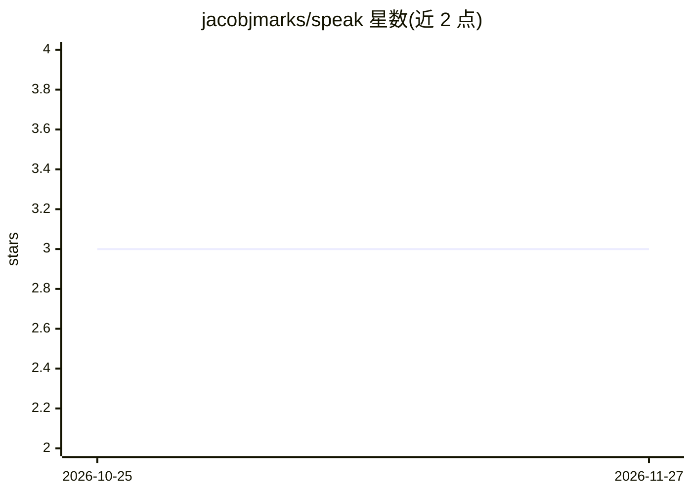

# jacobjmarks/speak

⭐ 3 · Python · 推送 2026-11-26 · [GitHub](https://github.com/jacobjmarks/speak) · 个人维护

**本地离线语音听写工具：按住按键说话，整理好的文字直接输入**

面向 Windows 与 macOS 的桌面听写应用：按住快捷键说话，松开后文字经整理（补标点、分段、去填充词、修正改口）后直接键入当前应用。语音识别与整理模型均在本地运行，语音不上传，仅首次需下载模型（约 700 MB，整理模型 0.5–2.5 GB）。支持 32 个语音区域设置与语言自动检测，可在普通笔记本运行，有显卡时可启用更大模型。基于 NVIDIA Nemotron 语音识别与 Qwen 整理模型构建。

## 筛选速览

| 维度 | 判定 | 备注 |
|---|---|---|
| AI 角色 | `ai-native` | 本体是模型或模型工具 |
| 许可风险 | `none` | — |
| 部署形态 | `desktop` | 安装包/桌面程序 |
| 模型依赖 | — | README 未给出锁定关系 |
| 硬件要求 | — | 无带数字的原话,不猜 |
| 安装摩擦 | `low` | 无编译、无系统依赖或容器化 |
| 成熟度 | — | 结构信号不足 |

## 能力要点

- 语音全程本地处理，无需账号与联网，支持完全离线
- 自动整理文本：标点、分段、大小写、去口头语与改口修正
- 32 个语音区域设置，可自动检测语言
- 自定义快捷键、整理档位、指示器与深浅色主题

## 适用场景

- 在任意应用中用语音代替键盘输入邮件、聊天与文档
- 不便联网的环境下进行语音听写
- 在意语音隐私、不希望音频上传云端的日常输入

## 场景标签

`语音识别` · 领域:感知与多模态

## 证据(README 行号)

> L3:  Talk anywhere. Speak types it for you, neatly, without your voice ever leaving your computer.
> L28: 3. Stop. Your text is tidied up and typed straight into the app you're using.

## 星数曲线

2026-10-25 3 → 2026-11-27 3（+0）

---
*卡片 v1 · prompt 1.4 · 生成 2026-11-21 · 置信度 high · 依据 README sha `11678e1bbdfb` · [字段定义](../../DATASET.md)*
