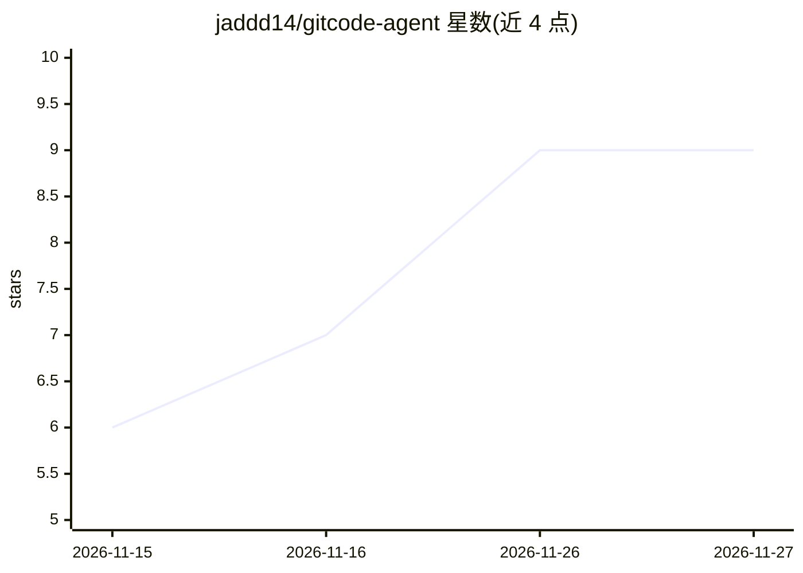

# jaddd14/gitcode-agent

⭐ 9 · Rust · MIT · 推送 2026-11-25 · [GitHub](https://github.com/jaddd14/gitcode-agent) · 个人维护

**本地优先的终端编码 agent：在仓库中读改代码并按权限执行**

用 Rust 编写的终端编码 agent，在现有仓库中通过配置的语言模型提供商调查并修改代码；读取/搜索文件、编辑文本与 notebook、应用补丁、运行 shell 命令，变更文件、执行命令或访问网络工具前请求用户许可。支持 Anthropic Messages、OpenAI Chat Completions/Responses 及兼容端点，会话本地保存并可恢复，接近上下文上限时自动摘要压缩。提供交互与非交互模式、MCP 工具调用、hooks 与用量统计。README 声明无内置文件访问边界，非 OS 沙箱。

## 筛选速览

| 维度 | 判定 | 备注 |
|---|---|---|
| AI 角色 | `ai-native` | 本体是模型或模型工具 |
| 许可风险 | `permissive` | MIT |
| 部署形态 | `None` |  |
| 模型依赖 | locked-api |  |
| 硬件要求 | — | 无带数字的原话,不猜 |
| 安装摩擦 | `medium` | 含编译或系统依赖之一 |
| 成熟度 | `idea` | |

## 能力要点

- 变更文件/执行命令/网络访问前请求许可的权限控制机制
- 支持 Anthropic、OpenAI 协议及兼容端点，凭据留在本地环境
- 会话本地保存、恢复，并可导入 Claude Code 与 Codex 日志
- 上下文接近上限时自动摘要压缩，保留原始会话

## 适用场景

- 在终端里让模型调查并修改现有仓库代码
- 通过非交互模式对仓库执行一次性任务
- 迁移或复用 Claude Code/Codex 的历史会话

## 场景标签

`编码 Agent` · 领域:编码与开发

## 证据(README 行号)

> L5:  The local-first terminal coding agent.
> L22: GitCode is a local-first terminal coding agent written in Rust. It works with an existing repository, uses a config
> L29: - Supports Anthropic Messages, OpenAI Chat Completions, OpenAI Responses, and compatible endpoints. Provider creden

## 星数曲线

2026-11-15 6 → 2026-11-27 9（+3）

---
*卡片 v1 · prompt 1.4 · 生成 2026-11-20 · 置信度 high · 依据 README sha `923a8852b405` · [字段定义](../../DATASET.md)*
