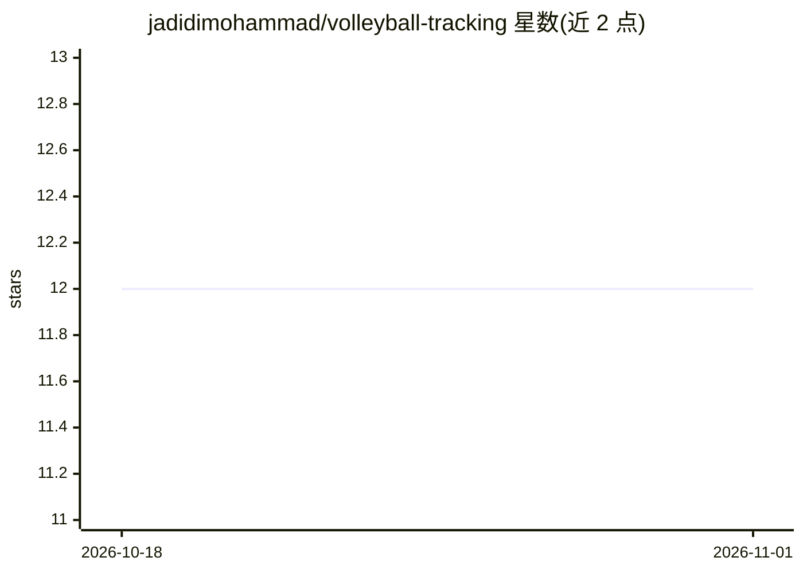

# jadidimohammad/volleyball-tracking

⭐ 12 · Python · GPL-3.0 · 推送 2026-02-14 · [GitHub](https://github.com/jadidimohammad/volleyball-tracking) · 个人维护

**基于 YOLO 的排球球体检测模型对比实验仓库**

在 Volleyvision 数据集（约 17000 张训练图、5000 张验证图）上训练并对比 YOLOv8/9/10/11/12/26 的 nano/small/medium 各规格模型，报告 Precision 与 Recall 指标；训练使用 2 块 T4 GPU，超参为 Epoch=100、batch=16、SGD 优化器、lr=0.01、momentum=0.937。依赖 ultralytics>=8.3、numpy、torch，面向复现实验或选取模型的计算机视觉开发者。

## 筛选速览

| 维度 | 判定 | 备注 |
|---|---|---|
| AI 角色 | `ai-native` | 本体是模型或模型工具 |
| 许可风险 | `viral` | GPL-3.0 |
| 部署形态 | `None` |  |
| 模型依赖 | — | README 未给出锁定关系 |
| 硬件要求 | — | 无带数字的原话,不猜 |
| 安装摩擦 | `low` | 无编译、无系统依赖或容器化 |
| 成熟度 | — | 结构信号不足 |

## 能力要点

- 对比 YOLOv8 至 v26 六代模型三种规格的 Precision/Recall
- 训练细节公开（Epoch/batch/优化器/学习率/动量）
- 基于 Volleyvision 排球数据集训练

## 适用场景

- 选型时查阅各版本 YOLO 在排球检测上的指标
- 复现相同超参的训练实验
- 获取排球球体检测的参考模型

## 场景标签

`目标检测` · 领域:感知与多模态

## 证据(README 行号)

> L1: # volleyball tracking
> L37: dataset: Volleyvision

## 星数曲线

2026-10-18 12 → 2026-11-01 12（+0）

---
*卡片 v1 · prompt 1.4 · 生成 2026-11-01 · 置信度 high · 依据 README sha `db1c943a2d88` · [字段定义](../../DATASET.md)*
