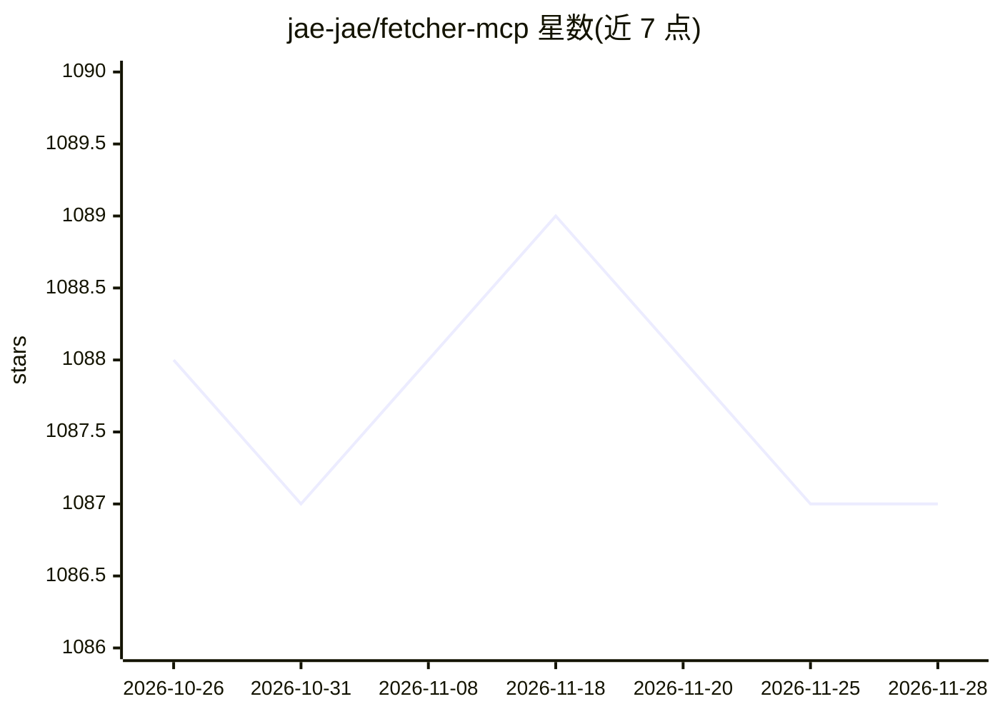

# jae-jae/fetcher-mcp

⭐ 1,087 · TypeScript · MIT · 推送 2026-11-05 · [GitHub](https://github.com/jae-jae/fetcher-mcp) · [官网](https://1team.top) · 个人维护 · 中文 README

**基于 Playwright 无头浏览器的 MCP 网页抓取服务器**

通过 Playwright 无头浏览器抓取网页内容，执行 JavaScript 以处理动态页面；内置 Readability 算法提取正文并去除广告、导航等元素，输出 HTML 或 Markdown。提供 fetch_url 与 fetch_urls（多标签并行抓取）两个工具，自动屏蔽图片、样式等资源以减少带宽。支持 stdio 与 Streamable HTTP/SSE 传输，提供 Docker 部署、调试模式（可显示浏览器窗口用于手动登录）与内网地址默认拦截。

## 筛选速览

| 维度 | 判定 | 备注 |
|---|---|---|
| AI 角色 | `ai-ecosystem` | LLM/agent 周边工具 |
| 许可风险 | `permissive` | MIT |
| 部署形态 | `self-host` | docker 或自建部署 |
| 模型依赖 | — | README 未给出锁定关系 |
| 硬件要求 | — | 无带数字的原话,不猜 |
| 安装摩擦 | `low` | 无编译、无系统依赖或容器化 |
| 成熟度 | — | 结构信号不足 |

## 能力要点

- Playwright 执行 JavaScript，支持动态网页与现代 Web 应用
- Readability 算法智能提取正文并转为 Markdown/HTML/纯文本
- fetch_urls 多标签并行批量抓取
- 默认拦截回环/内网/云元数据目标，HTTP 端点无鉴权需注意部署环境

## 适用场景

- 为支持 MCP 的客户端提供网页内容抓取能力
- 批量并行抓取多个 URL 并统一输出 Markdown
- 需要手动登录后抓取需要鉴权的页面

## 场景标签

`网页抓取` · 领域:效率与自动化

## 证据(README 行号)

> L14: MCP server for fetch web page content using Playwright headless browser.
> L61: - `POST /tools/{name}` - REST endpoint for each tool (`fetch_url`, `fetch_urls`, `browser_install`)

## 星数曲线

2026-10-26 1,088 → 2026-11-28 1,087（-1）

---
*卡片 v1 · prompt 1.4 · 生成 2026-11-24 · 置信度 high · 依据 README sha `dad52628d081` · [字段定义](../../DATASET.md)*
