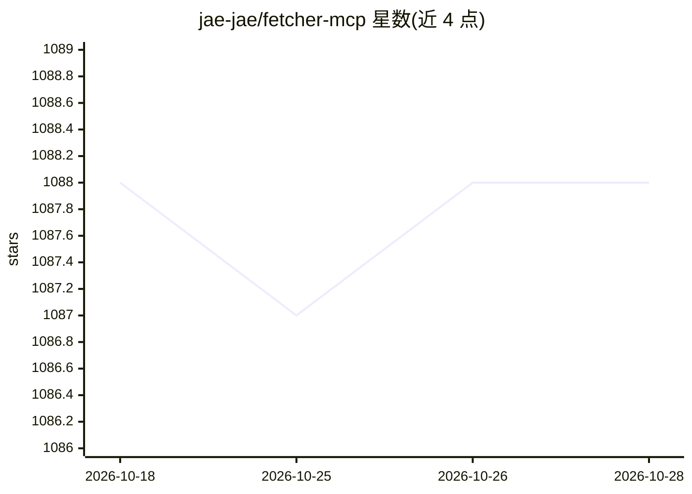

# jae-jae/fetcher-mcp

⭐ 1,088 · TypeScript · MIT · 推送 2026-01-14 · [GitHub](https://github.com/jae-jae/fetcher-mcp) · [官网](https://1team.top) · 个人维护 · 中文 README

**基于 Playwright 无头浏览器的网页抓取 MCP 服务器**

为 MCP 客户端提供网页内容抓取工具的 MCP 服务器：通过 Playwright 无头浏览器执行 JavaScript 以处理动态网页，内置 Readability 算法提取主体内容，输出 HTML 或 Markdown；支持单 URL 抓取与多标签页并行批量抓取，自动屏蔽图片等资源以减少带宽。提供 fetch_url、fetch_urls、browser_install 三个工具，可配置超时、等待导航等参数，支持 HTTP/SSE 传输。可通过 npx 直接运行或 Docker 部署，需先安装 Chromium 浏览器。

## 筛选速览

| 维度 | 判定 | 备注 |
|---|---|---|
| AI 角色 | `ai-ecosystem` | LLM/agent 周边工具 |
| 许可风险 | `permissive` | MIT |
| 部署形态 | `self-host` | docker 或自建部署 |
| 模型依赖 | — | README 未给出锁定关系 |
| 硬件要求 | — | 无带数字的原话,不猜 |
| 安装摩擦 | `low` | 无编译、无系统依赖或容器化 |
| 成熟度 | — | 结构信号不足 |

## 能力要点

- Playwright 执行 JavaScript，可处理动态网页内容
- Readability 算法提取主体内容，支持 HTML/Markdown 输出
- fetch_urls 多标签页并行批量抓取
- 支持 Streamable HTTP 与 SSE 两种传输端点

## 适用场景

- 让 Claude 等 MCP 客户端读取需要执行 JavaScript 的动态网页
- 批量并行抓取多个网页内容供 AI 处理
- 配合调试模式手动登录后抓取需认证的页面

## 场景标签

`网页抓取` · 领域:效率与自动化

## 证据(README 行号)

> L14: MCP server for fetch web page content using Playwright headless browser.
> L73: Configure this MCP server in Claude Desktop:

## 星数曲线

2026-10-18 1,088 → 2026-10-28 1,088（+0）

---
*卡片 v1 · prompt 1.4 · 生成 2026-10-21 · 置信度 high · 依据 README sha `6c1b3c566ccf` · [字段定义](../../DATASET.md)*
