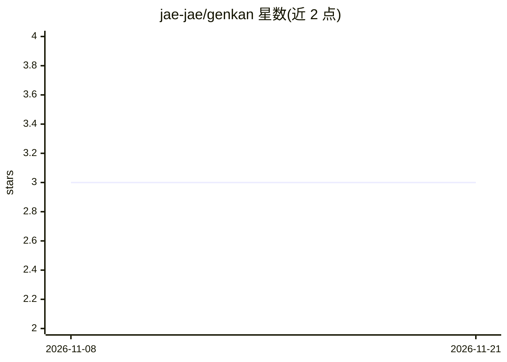

# jae-jae/genkan

⭐ 3 · Go · MIT · 推送 2026-11-18 · [GitHub](https://github.com/jae-jae/genkan) · [官网](https://1team.top) · 个人维护 · 中文 README

**家庭实验室的 AI 对话式起始页/仪表盘**

自托管的家庭实验室起始页，通过连接 Claude、Cursor 等 AI agent，以自然语言对话管理服务链接、分组、固定项、小部件与插件，更改即时生效并实时更新。本体功能包括多工作区、使用频率排序、快速搜索、17 个内置插件（待办、天气、Pi-hole 等）、沙箱化 JS/TS 插件引擎、健康检查与登录/访客模式。单个 Go 二进制，约 11 MB 镜像、约 6 MB 内存，支持 Docker 部署于 amd64/arm64。

## 筛选速览

| 维度 | 判定 | 备注 |
|---|---|---|
| AI 角色 | `ai-enhanced` | 去掉 AI 部分产品仍成立 |
| 许可风险 | `permissive` | MIT |
| 部署形态 | `self-host` | docker 或自建部署 |
| 模型依赖 | — | README 未给出锁定关系 |
| 硬件要求 | — | 无带数字的原话,不猜 |
| 安装摩擦 | `low` | 无编译、无系统依赖或容器化 |
| 成熟度 | — | 结构信号不足 |

## 能力要点

- 通过 Agent Skill 或内置 MCP 服务器以对话方式管理链接、小部件与插件
- JavaScript/TypeScript 插件在沙箱纯 Go 引擎中服务端运行，浏览器不执行插件代码
- 17 个内置插件与基于 GitHub topic 发现的第三方插件市场
- 单 Go 二进制，约 11 MB 镜像与约 6 MB 内存，无遥测

## 适用场景

- 为家庭实验室的 NAS、媒体服务整理统一的起始页
- 用自然语言让 AI 助手批量整理服务分组和健康检查
- 安装或让 AI 编写自定义仪表盘小部件插件

## 场景标签

`AI 助手` · 领域:对话与助手

## 证据(README 行号)

> L3: **The AI-native start page for your homelab.**
> L31: - **AI-native**: talk to your AI assistant via the Agent Skill or built-in MCP server to manage links, widgets and 
> L36: - **Plugins & widgets**: JavaScript / TypeScript plugins run in a sandboxed pure-Go engine (moejs) to add interacti

## 星数曲线

2026-11-08 3 → 2026-11-21 3（+0）

---
*卡片 v1 · prompt 1.4 · 生成 2026-11-21 · 置信度 high · 依据 README sha `6763cea652bc` · [字段定义](../../DATASET.md)*
