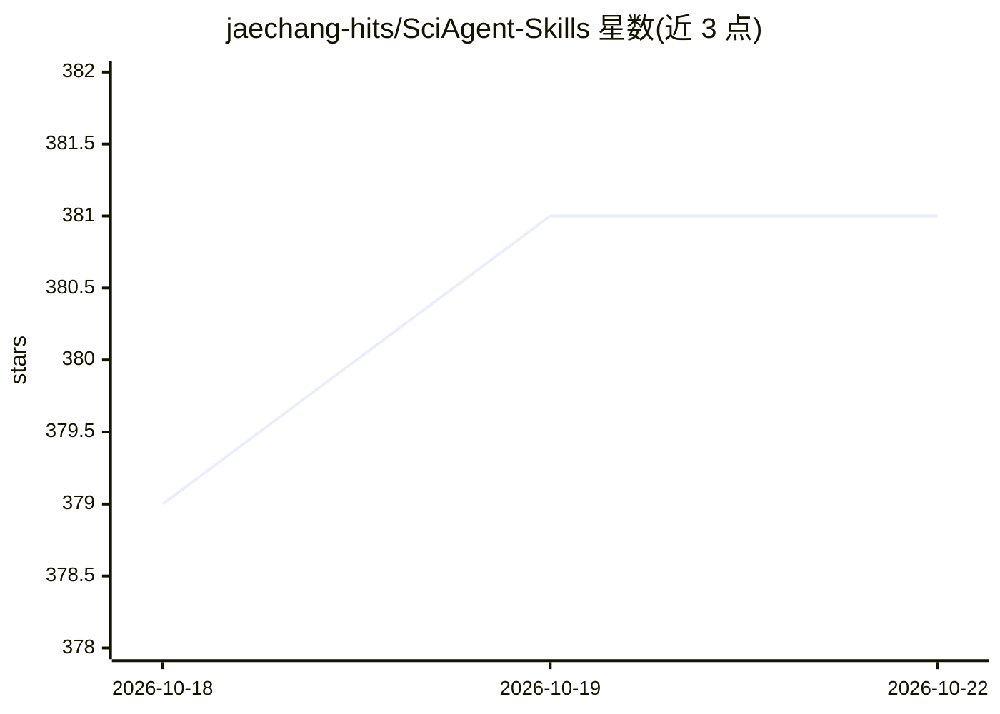

# jaechang-hits/SciAgent-Skills

⭐ 381 · Python · NOASSERTION · 推送 2026-10-22 · [GitHub](https://github.com/jaechang-hits/SciAgent-Skills) · [官网](https://omicshorizon.ai/en/) · 个人维护

**面向 AI 编码 agent 的 199 个生物信息学技能库**

以 SKILL.md 格式组织的科学技能集合：199 个自包含技能覆盖基因组学、结构生物学与药物发现、生物统计、科学写作等 10 类，含可运行代码示例、参数说明与排错表。主要面向 Claude Code（可作为插件加载），也兼容 Codex CLI、Cursor、Windsurf 等任何能读取 markdown 文件的 agent，经 registry.yaml 发现技能。无运行时依赖，git clone 后按模板接入即可；验证脚本需 Python 3.12+ 与 pixi。README 报告 BixBench-Verified-50 上 92.0% 准确率（基线 65.3%）。许可为 CC-BY-4.0。

## 筛选速览

| 维度 | 判定 | 备注 |
|---|---|---|
| AI 角色 | `ai-knowledge` | 知识聚合/清单类 |
| 许可风险 | `none` | NOASSERTION |
| 部署形态 | `library` | 以包/库形式分发 |
| 模型依赖 | — | README 未给出锁定关系 |
| 硬件要求 | — | 无带数字的原话,不猜 |
| 安装摩擦 | `low` | 无编译、无系统依赖或容器化 |
| 成熟度 | — | 结构信号不足 |

## 能力要点

- 199 个 SKILL.md 格式技能，分 10 类（基因组学 65、药物发现 26、科学计算 24 等）
- 官方报告 BixBench-Verified-50 92.0%（基线 65.3%）
- 支持 Claude Code 插件方式与 AGENTS.md/rules 文件方式接入多类 agent
- 无运行时依赖，markdown 文件由 agent 直接读取

## 适用场景

- 给 Claude Code 等 AI 编码 agent 加载生物信息学领域知识
- 在编码 agent 中执行 RNA-seq、单细胞、药物筛选等分析任务
- 为科研项目按 registry.yaml 组织领域技能

## 场景标签

`科研工具` `教程课程` · 领域:学习与行业

## 证据(README 行号)

> L10: **SciAgent-Skills** is the largest open-source skill library for scientific AI agents. It equips Claude Code (and a
> L35: Each skill is a self-contained SKILL.md file with runnable code examples, key parameters, troubleshooting guides, a

## 星数曲线

2026-10-18 379 → 2026-10-22 381（+2）

---
*卡片 v1 · prompt 1.4 · 生成 2026-10-21 · 置信度 mid · 依据 README sha `d33b49495acd` · [字段定义](../../DATASET.md)*
