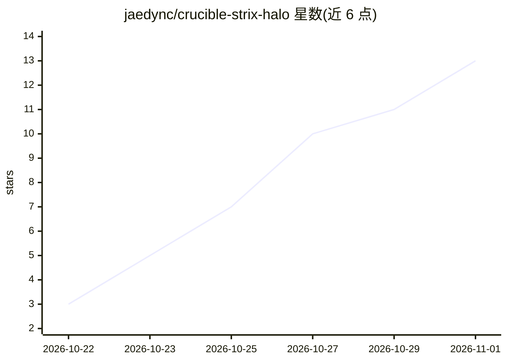

# jaedync/crucible-strix-halo

⭐ 13 · Python · Apache-2.0 · 推送 2026-10-25 · [GitHub](https://github.com/jaedync/crucible-strix-halo) · [官网](https://srv.jaedyn.me/strix-halo-engine-optimization/index.html) · 个人维护

**在 AMD Strix Halo 上运行 Qwen3.8-Flash-Next EXL3 的 C++20 推理引擎**

面向单一硬件（Ryzen AI Max+ 395 / Radeon 8060S / gfx1151，128 GB 统一内存）的自研 ROCm/HIP 内核 C++20 推理引擎，不依赖其他引擎。运行 Qwen3.8-Flash-Next 的 EXL3 量化包（3.05 与 4.05 bpw），提供本地 OpenAI 兼容服务器，支持聊天、流式响应、函数调用、图像输入与精确投机解码（MTP，输出逐位一致）。README 大量披露重复测量的速度数据，并注明这是面向一种 GPU 架构的研究软件，非通用后端或生产服务。

## 筛选速览

| 维度 | 判定 | 备注 |
|---|---|---|
| AI 角色 | `ai-ecosystem` | LLM/agent 周边工具 |
| 许可风险 | `permissive` | Apache-2.0 |
| 部署形态 | `desktop` | 安装包/桌面程序 |
| 模型依赖 | — | README 未给出锁定关系 |
| 硬件要求 | — | 无带数字的原话,不猜 |
| 安装摩擦 | `medium` | 含编译或系统依赖之一 |
| 成熟度 | `idea` | |

## 能力要点

- 自研 ROCm/HIP C++20 内核，不依赖其他推理引擎
- OpenAI 兼容本地服务器：聊天/流式/函数调用/图像输入
- MTP 投机解码输出与基准逐位一致（bitwise-equal 门控）
- 3.05 与 4.05 bpw 双量化包，4 会话并发与对话缓存实测数据

## 适用场景

- 在 Strix Halo APU 上本地运行 Qwen3.8-Flash-Next 长上下文推理
- 多会话 agent 工作负载的本地 OpenAI 兼容服务
- 参考其在 AMD gfx1151 上的量化推理实测数据

## 场景标签

`推理引擎` · 领域:训练与推理

## 证据(README 行号)

> L7: Crucible runs **EXL3** checkpoints of **Qwen3.8-Flash-Next** on **AMD Strix Halo**:
> L9: **ROCm/HIP** kernels in C++20. It does not use another engine for inference. A local OpenAI-compatible server
> L10: gives chat, streamed responses, function calls, and exact speculative decoding. This is research software for

## 星数曲线

2026-10-22 3 → 2026-11-01 13（+10）

---
*卡片 v1 · prompt 1.4 · 生成 2026-10-31 · 置信度 mid · 依据 README sha `6ff5ea4c53e0` · [字段定义](../../DATASET.md)*
