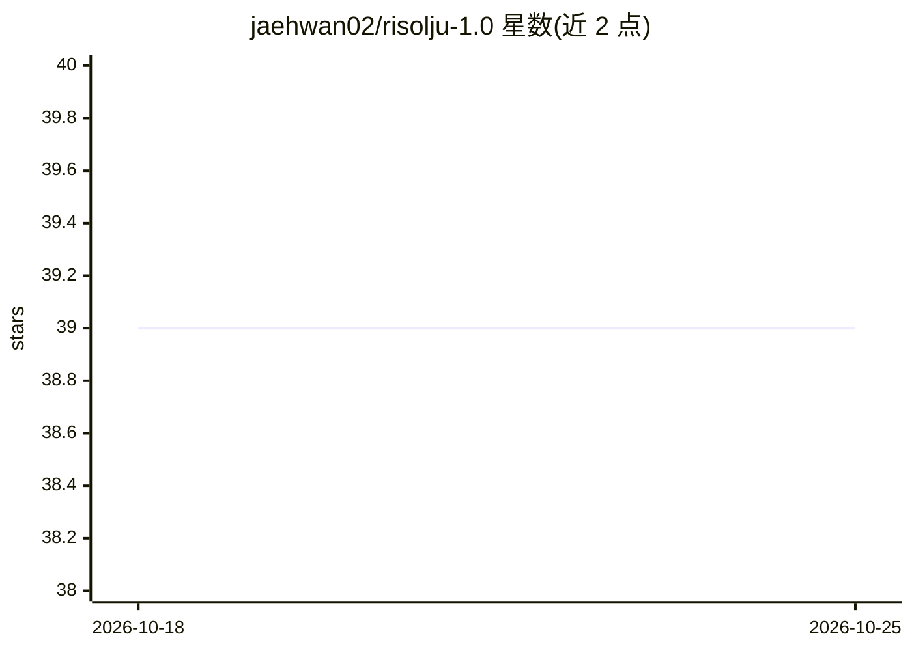

# jaehwan02/risolju-1.0

⭐ 39 · TypeScript · Apache-2.0 · 推送 2026-05-27 · [GitHub](https://github.com/jaehwan02/risolju-1.0) · [官网](https://jaehwan02.github.io/risolju-1.0/) · 个人维护

**朝鲜语体对话模型：模拟朝鲜式文体语汇的韩语 LLM**

以韩语对话模型为基础微调出的语言风格/角色模拟模型 risolju-1.0，提供 7B、1.7B 两个规模及面向浏览器 WebLLM（MLC/WebGPU）的 1.7b-mlc 版本；7B 基于 skt/A.X-4.0-Light（Qwen2.5 架构），1.7B 基于 Qwen3-1.7B。GitHub 仓库仅作模型介绍与 Hugging Face 链接入口，模型文件托管在 Hugging Face，附浏览器在线演示与 transformers 使用示例。声明不与朝鲜政府等任何政治机构相关，禁止用于政治宣传等用途。Apache 2.0 许可。

## 筛选速览

| 维度 | 判定 | 备注 |
|---|---|---|
| AI 角色 | `ai-native` | 本体是模型或模型工具 |
| 许可风险 | `permissive` | Apache-2.0 |
| 部署形态 | `None` |  |
| 模型依赖 | — | README 未给出锁定关系 |
| 硬件要求 | — | 无带数字的原话,不猜 |
| 安装摩擦 | `low` | 无编译、无系统依赖或容器化 |
| 成熟度 | — | 结构信号不足 |

## 能力要点

- 7B 与 1.7B 两个规模的朝鲜语体微调模型
- 提供 MLC/WebGPU 格式版本，可在浏览器 WebLLM 中运行
- 提供浏览器在线演示与 transformers 使用示例

## 适用场景

- 研究朝鲜式韩语文体、词汇与语气的语言风格模拟
- 在浏览器中直接体验该模型（WebLLM 版本）
- 作为角色模拟对话模型进行实验

## 场景标签

`聊天机器人` · 领域:对话与助手

## 证据(README 行号)

> L5: RiSolJu 1.0은 북한식 문체, 어휘, 말투, 배경 맥락을 반영하도록 조정한 한국어 대화형 언어 모델입니다.
> L7: 이 GitHub 저장소는 모델 소개와 Hugging Face 링크를 제공하기 위한 간단한 공개 저장소입니다. 전체 모델 파일, 토크나이저, 설정 파일은 Hugging Face에 업로드되어 있습니다.
> L15: - `risolju-1.0-7b`: skt/A.X-4.0-Light 기반 파인튜닝 모델입니다. A.X-4.0-Light는 Qwen2/Qwen2.5 계열 아키텍처의 한국어 7B 모델입니다.

## 星数曲线

2026-10-18 39 → 2026-10-25 39（+0）

---
*卡片 v1 · prompt 1.4 · 生成 2026-10-25 · 置信度 high · 依据 README sha `7e9cca606875` · [字段定义](../../DATASET.md)*
