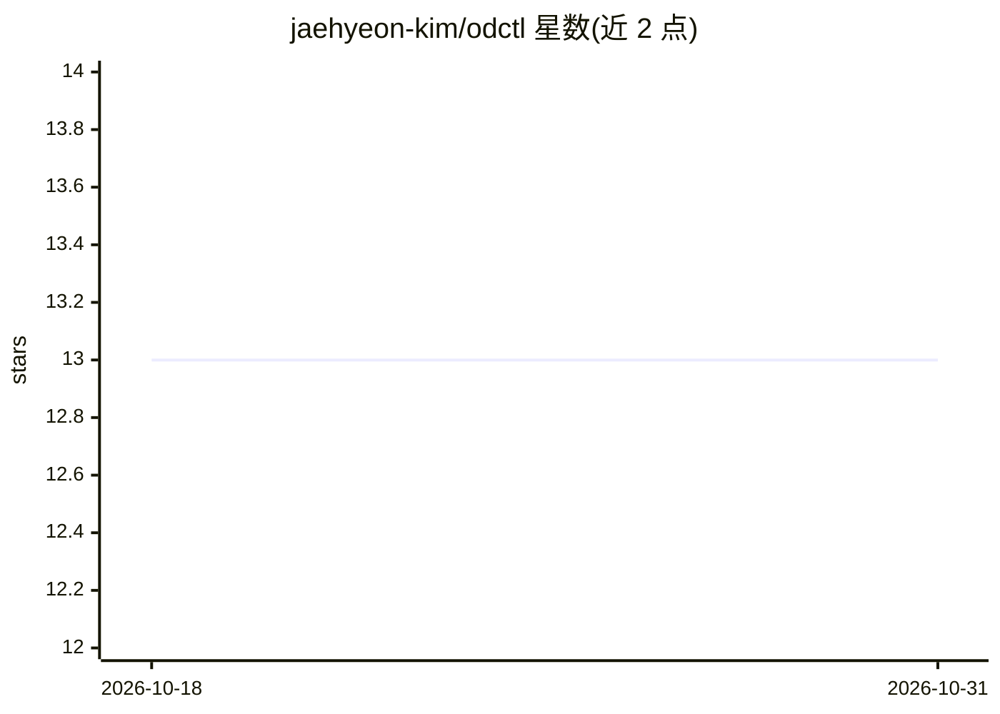

# jaehyeon-kim/odctl

⭐ 13 · Python · Apache-2.0 · 推送 2026-10-30 · [GitHub](https://github.com/jaehyeon-kim/odctl) · [官网](https://jaehyeon.me/odctl) · 个人维护

**本地一键启动开源数据栈的 CLI：Docker Compose 编排大数据/MLOps 服务**

odctl 是一个命令行工具，用 Docker Compose 在本机运行 Kafka、Flink、Spark、Iceberg、Trino、ClickHouse、MLflow、Feast、Airflow 等开源数据工程与 MLOps 服务。用户通过 profile 名称（如 kafka-lite、airflow）选择组合，工具自动启动依赖服务并接通；提供 init/list/up/down/logs 等命令，compose 文件可复制到 .odctl 目录编辑。要求 Docker 运行中与 Python 3.10+，通过 uv tool 或 pipx 安装。

## 筛选速览

| 维度 | 判定 | 备注 |
|---|---|---|
| AI 角色 | `ai-ecosystem` | LLM/agent 周边工具 |
| 许可风险 | `permissive` | Apache-2.0 |
| 部署形态 | `self-host` | docker 或自建部署 |
| 模型依赖 | — | README 未给出锁定关系 |
| 硬件要求 | — | 无带数字的原话,不猜 |
| 安装摩擦 | `low` | 无编译、无系统依赖或容器化 |
| 成熟度 | — | 结构信号不足 |

## 能力要点

- 按 profile 启动服务组合并自动启动依赖项
- 覆盖 Kafka/Flink/Spark/Iceberg/Trino/ClickHouse/MLflow/Feast/Airflow 等
- compose 文件可复制到 .odctl 目录进行编辑
- 通过 uv tool / pipx 安装，Python 3.10+，需 Docker

## 适用场景

- 在本机搭建一套互相连通的数据工程/MLOps 服务栈
- 本地运行 Iceberg 湖仓与 Trino 查询做数据分析实验
- 为数据管道或 agent 项目提供本地基础设施

## 场景标签

`MLOps` · 领域:训练与推理

## 证据(README 行号)

> L9: odctl is a command-line tool that runs an open data stack on your machine with Docker Compose: Kafka, Flink, Spark, 
> L17: odctl needs Docker running and Python 3.10 or later. Requirements says how much memory to give Docker. Install odct

## 星数曲线

2026-10-18 13 → 2026-10-31 13（+0）

---
*卡片 v1 · prompt 1.4 · 生成 2026-10-31 · 置信度 high · 依据 README sha `5f1749ccfff0` · [字段定义](../../DATASET.md)*
