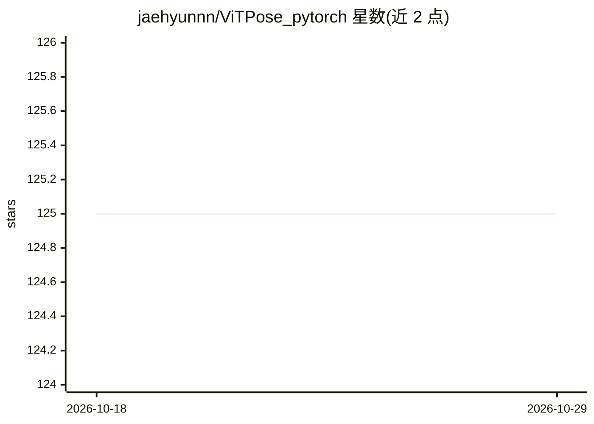

# jaehyunnn/ViTPose_pytorch

⭐ 125 · Jupyter Notebook · Apache-2.0 · 推送 2026-01-21 · [GitHub](https://github.com/jaehyunnn/ViTPose_pytorch) · 个人维护

**ViTPose 人体姿态估计的非官方 PyTorch 实现**

基于 Vision Transformer 的 2D 人体姿态估计模型 ViTPose 的非官方 PyTorch 实现，不依赖 mmcv。提供 ViTPose-B/L/H 三种规模模型的配置与预训练权重下载，支持对单张图片运行推理，也支持通过 train.py 用配置文件训练。安装方式为 git clone 源码后 pip 安装依赖，需 Python>=3.8 与 PyTorch>=1.9.0。代码参考官方 ViTPose 仓库编写。

## 筛选速览

| 维度 | 判定 | 备注 |
|---|---|---|
| AI 角色 | `ai-native` | 本体是模型或模型工具 |
| 许可风险 | `permissive` | Apache-2.0 |
| 部署形态 | `library` | 以包/库形式分发 |
| 模型依赖 | — | README 未给出锁定关系 |
| 硬件要求 | — | 无带数字的原话,不猜 |
| 安装摩擦 | `low` | 无编译、无系统依赖或容器化 |
| 成熟度 | — | 结构信号不足 |

## 能力要点

- 提供 ViTPose-B/L/H 三种规模预训练权重与配置
- 支持图片推理（inference.py）与训练（train.py）
- 实现不依赖 mmcv

## 适用场景

- 对图片执行人体关键点/姿态估计推理
- 在自己的数据集上微调训练 ViTPose 模型

## 场景标签

 · 领域:计算机视觉/人体姿态估计

## 证据(README 行号)

> L2: An unofficial implementation of `ViTPose` [Y. Xu et al., 2022]
> L34: python inference.py --image-path './examples/img1.jpg'

## 星数曲线

2026-10-18 125 → 2026-10-29 125（+0）

---
*卡片 v1 · prompt 1.4 · 生成 2026-10-23 · 置信度 mid · 依据 README sha `ac7ced78e39d` · [字段定义](../../DATASET.md)*
