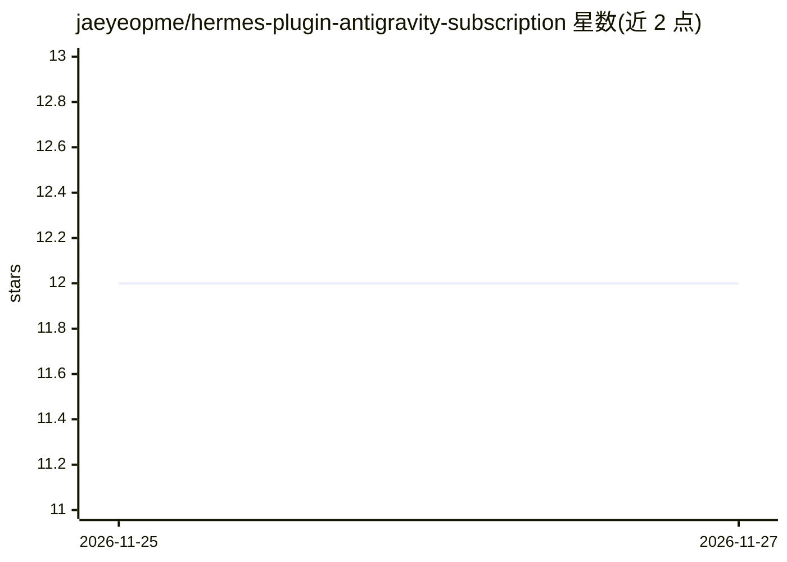

# jaeyeopme/hermes-plugin-antigravity-subscription

⭐ 12 · Python · MIT · 推送 2026-11-26 · [GitHub](https://github.com/jaeyeopme/hermes-plugin-antigravity-subscription) · [官网](https://github.com/jaeyeopme/hermes-plugin-antigravity-subscription#readme) · 个人维护

**用 Google Antigravity 账号在 Hermes 中接入 Gemini/Claude/gpt-oss 模型的插件**

Hermes 的模型提供方插件：通过 Google Antigravity 账号的 OAuth 登录接入其 Gemini、Claude 与 gpt-oss 模型，无需 API key 或本地代理。注册 google-antigravity provider，支持流式对话、工具调用、图片输入与推理等级调节；模型目录从账号实时读取并缓存 4 小时，新模型无需更新插件即可出现。将 Hermes 的 OpenAI 风格请求在进程内转换后发给后端，失败以 Hermes provider 错误呈现以触发重试与回退。需要 Hermes >=0.21.5 与 Python 3.11+，仅为非官方集成，存在账号被限制的风险。

## 筛选速览

| 维度 | 判定 | 备注 |
|---|---|---|
| AI 角色 | `ai-ecosystem` | LLM/agent 周边工具 |
| 许可风险 | `permissive` | MIT |
| 部署形态 | `library` | 以包/库形式分发 |
| 模型依赖 | — | README 未给出锁定关系 |
| 硬件要求 | — | 无带数字的原话,不猜 |
| 安装摩擦 | `low` | 无编译、无系统依赖或容器化 |
| 成熟度 | — | 结构信号不足 |

## 能力要点

- OAuth 登录 Google 账号直连 Antigravity，无需 API key 与本地代理
- 支持流式对话、工具调用、图片（data URL）与推理等级（off/minimal/low/medium/high）
- 模型目录从账号读取并缓存 4 小时，新模型无需发版即可使用
- 请求在进程内转换，失败交由 Hermes 的重试与回退机制处理

## 适用场景

- 在 Hermes 中用 Antigravity 订阅账号调用 Gemini/Claude 模型
- 不申请 API key 而直接复用已有 Google 账号的模型额度
- 在远程机器上通过 SSH 端口转发完成登录使用

## 场景标签

`模型网关` · 领域:Agent 开发

## 证据(README 行号)

> L5: A Hermes model provider plugin for the Gemini, Claude, and gpt-oss
> L18: - Registers the `google-antigravity` provider in Hermes, with the models your account lists.

## 星数曲线

2026-11-25 12 → 2026-11-27 12（+0）

---
*卡片 v1 · prompt 1.4 · 生成 2026-11-24 · 置信度 mid · 依据 README sha `6670e9de390c` · [字段定义](../../DATASET.md)*
