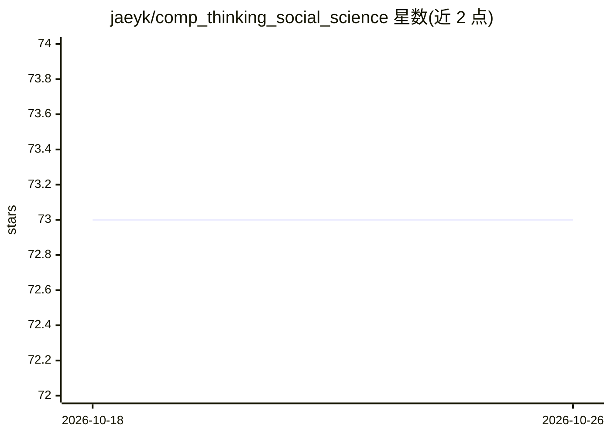

# jaeyk/comp_thinking_social_science

⭐ 73 · TeX · CC0-1.0 · 推送 2026-02-01 · [GitHub](https://github.com/jaeyk/comp_thinking_social_science) · [官网](https://jaeyk.github.io/comp_thinking_social_science/) · 个人维护

**面向社会科学家的计算思维开源教材项目**

Jekyll 静态站点形式的在线书籍仓库，帮助社会科学家建立计算思维并掌握计算社会科学研究所需的工具与技术。内容分基础与应用两部分、六个主题：Git/Bash 的数据与代码管理、数据整理建模与可视化、函数编写与数据工具开发（如 R 包和 Shiny 应用）、API 与网络爬虫数据采集、文本等高维数据的机器学习分析、SQL 大数据查询管理。教材大量内容改编自 UC Berkeley 研究生课程 PS239T 及多个工作坊，采用 CC BY 4.0 许可。

## 筛选速览

| 维度 | 判定 | 备注 |
|---|---|---|
| AI 角色 | `ai-knowledge` | 知识聚合/清单类 |
| 许可风险 | `viral` | CC0-1.0 |
| 部署形态 | `None` |  |
| 模型依赖 | — | README 未给出锁定关系 |
| 硬件要求 | — | 无带数字的原话,不猜 |
| 安装摩擦 | `low` | 无编译、无系统依赖或容器化 |
| 成熟度 | — | 结构信号不足 |

## 能力要点

- 基础与应用两部分共六个主题的计算社会科学教程
- 覆盖 Git/Bash、R 数据工具开发、网络爬虫、文本机器学习、SQL
- 内容源自 UC Berkeley PS239T 课程与多个工作坊，注明全部引用来源
- 以 CC BY 4.0 许可发布

## 适用场景

- 社会科学家系统学习计算方法入门
- 查找数据采集、文本机器学习、SQL 等主题的教学材料
- 作为计算社会科学课程的参考资料

## 场景标签

`教程课程` · 领域:学习与行业

## 证据(README 行号)

> L5: This is the git repository for *Computational Thinking for Social Scientists*. This book intends to help social scie
> L7: The book is divided into two main subjects (fundamentals and applications) and six main sessions.

## 星数曲线

2026-10-18 73 → 2026-10-26 73（+0）

---
*卡片 v1 · prompt 1.4 · 生成 2026-10-24 · 置信度 high · 依据 README sha `a85e36f63f89` · [字段定义](../../DATASET.md)*
