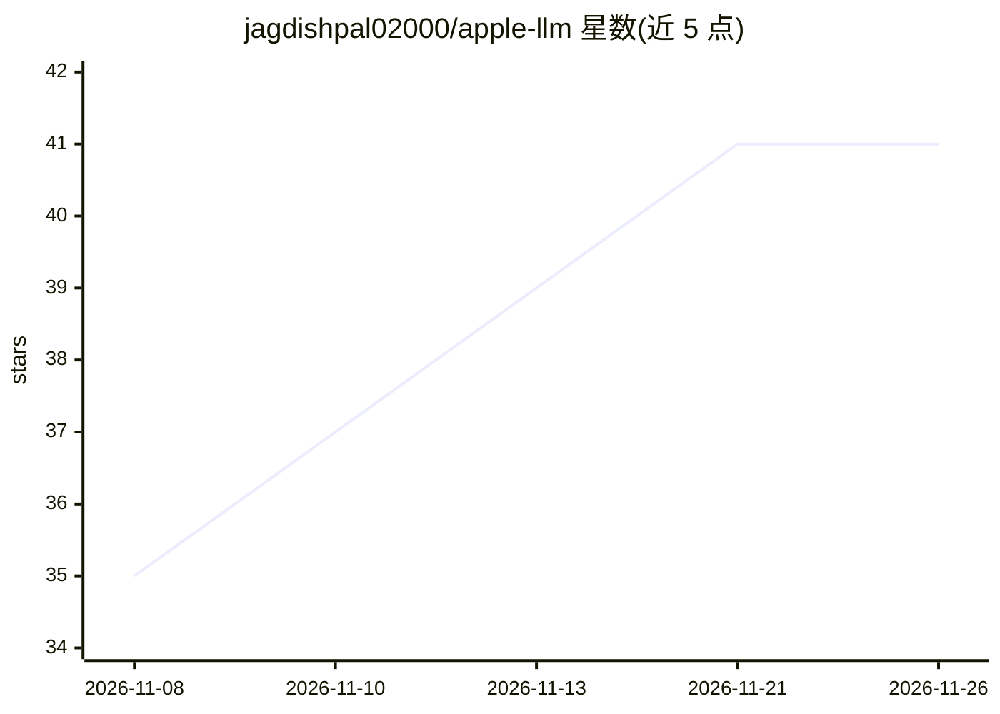

# jagdishpal02000/apple-llm

⭐ 41 · TypeScript · MIT · 推送 2026-11-22 · [GitHub](https://github.com/jagdishpal02000/apple-llm) · [官网](https://jagdishpal02000.github.io/apple-llm/) · 个人维护

**调用 Mac 内置 Apple 模型与语音能力的 Node/Python 库**

封装 macOS 内置的 Apple Intelligence 端侧 Foundation Models 与 Private Cloud Compute 云端模型，以 npm/PyPI 包、CLI 和 OpenAI/Ollama 兼容服务器三种形式提供文本生成、结构化 JSON 输出、TTS 与 STT；无需 API key 与 Xcode。端侧约 20B sparse 模型（8192 token 上下文），云端经 Private Cloud Compute 且有每机限速。仅支持 macOS 26+ Apple Silicon，首次使用时编译一个小型 Swift helper。

## 筛选速览

| 维度 | 判定 | 备注 |
|---|---|---|
| AI 角色 | `ai-native` | 本体是模型或模型工具 |
| 许可风险 | `permissive` | MIT |
| 部署形态 | `library` | 以包/库形式分发 |
| 模型依赖 | local-ok | 支持本地模型 |
| 硬件要求 | — | 无带数字的原话,不猜 |
| 安装摩擦 | `low` | 无编译、无系统依赖或容器化 |
| 成熟度 | — | 结构信号不足 |

## 能力要点

- 端侧模型支持约束解码，JSON 输出有保证
- 服务器同时兼容 OpenAI API 与 Ollama API（可占 Ollama 端口）
- TTS 支持 184 个系统语音、任意时长渲染与字幕生成（SRT/VTT）
- STT 支持 68 种语言、词级时间戳与提示词

## 适用场景

- 在 Mac 上免 API key 做本地文本生成、分类与抽取
- 让 Open WebUI、Zed 等本地模型应用直接使用 Apple 端侧模型
- 批量转录会议录音或实时麦克风转写并生成字幕

## 场景标签

`推理引擎` `语音合成` `语音识别` · 领域:内容生成

## 证据(README 行号)

> L4: built-in models — the on-device Foundation Models LLM behind Apple
> L61: npx apple-llm serve                # OpenAI at http://127.0.0.1:11436/v1, model "apple-on-device"
> L71: npx apple-llm transcribe meeting.mp4          # audio or video to text

## 星数曲线

2026-11-08 35 → 2026-11-26 41（+6）

---
*卡片 v1 · prompt 1.4 · 生成 2026-11-18 · 置信度 high · 依据 README sha `8080f20371ae` · [字段定义](../../DATASET.md)*
