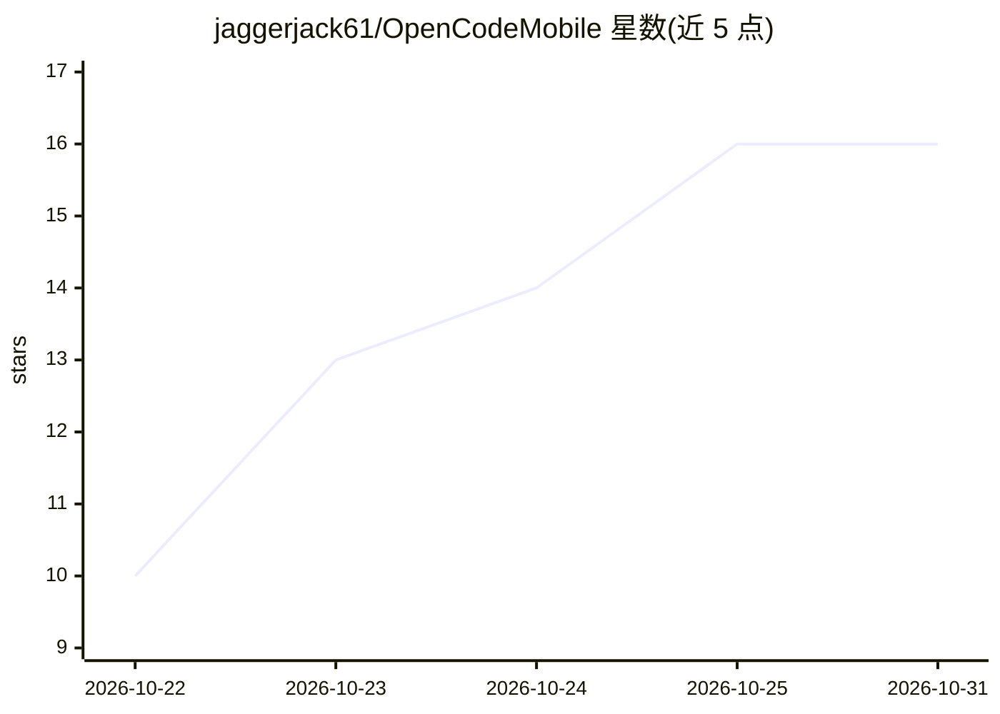

# jaggerjack61/OpenCodeMobile

⭐ 16 · Kotlin · MIT · 推送 2026-10-19 · [GitHub](https://github.com/jaggerjack61/OpenCodeMobile) · [官网](https://github.com/jaggerjack61/OpenCodeMobile/releases/latest) · 个人维护

**OpenCode Go 的原生 Android 聊天客户端**

Kotlin + Jetpack Compose 编写的 Android 应用，接入 OpenCode Go 的 OpenAI 兼容端点，可对话 GLM、Kimi、DeepSeek、Qwen、MiniMax 等 25 个内置模型。支持流式 Markdown 渲染、按会话调节思考力度（Auto 到 Max 八档）、可见的思维链与工具调用步骤、免 API key 的 Brave/DuckDuckGo 网络搜索引用、图片与音频附件、沙箱 shell 工具（默认关闭）以及 5 小时/周/月用量面板。API key 用 Android Keystore 加密，对话仅存本地。需 Android 8.0+ 和 OpenCode 订阅，以 APK 形式分发。

## 筛选速览

| 维度 | 判定 | 备注 |
|---|---|---|
| AI 角色 | `ai-native` | 本体是模型或模型工具 |
| 许可风险 | `permissive` | MIT |
| 部署形态 | `desktop` | 安装包/桌面程序 |
| 模型依赖 | — | README 未给出锁定关系 |
| 硬件要求 | — | 无带数字的原话,不猜 |
| 安装摩擦 | `low` | 无编译、无系统依赖或容器化 |
| 成熟度 | — | 结构信号不足 |

## 能力要点

- 25 个 OpenCode Go 模型可搜索切换，支持自定义模型 ID
- 思考力度按会话八档可调，Thought/Searched/Ran 步骤可展开查看
- 免搜索 API key 的网页搜索与来源引用
- API key 经 Android Keystore 加密，对话不离开设备

## 适用场景

- 在手机上使用 OpenCode Go 订阅对话各家模型
- 查看模型回答前的推理与搜索步骤
- 跟踪订阅的 5 小时/周/月用量限额

## 场景标签

`聊天机器人` · 领域:对话与助手

## 证据(README 行号)

> L3: **A native Android client for OpenCode Go.**
> L22: - **Streaming chat** with Markdown rendering: headings, lists, tables, inline code and scrollable code blocks.
> L230: - Chats are sent to `POST {baseUrl}/chat/completions` with `stream: true`, and parsed as server-sent events.

## 星数曲线

2026-10-22 10 → 2026-10-31 16（+6）

---
*卡片 v1 · prompt 1.4 · 生成 2026-10-30 · 置信度 high · 依据 README sha `cf6135cc2830` · [字段定义](../../DATASET.md)*
