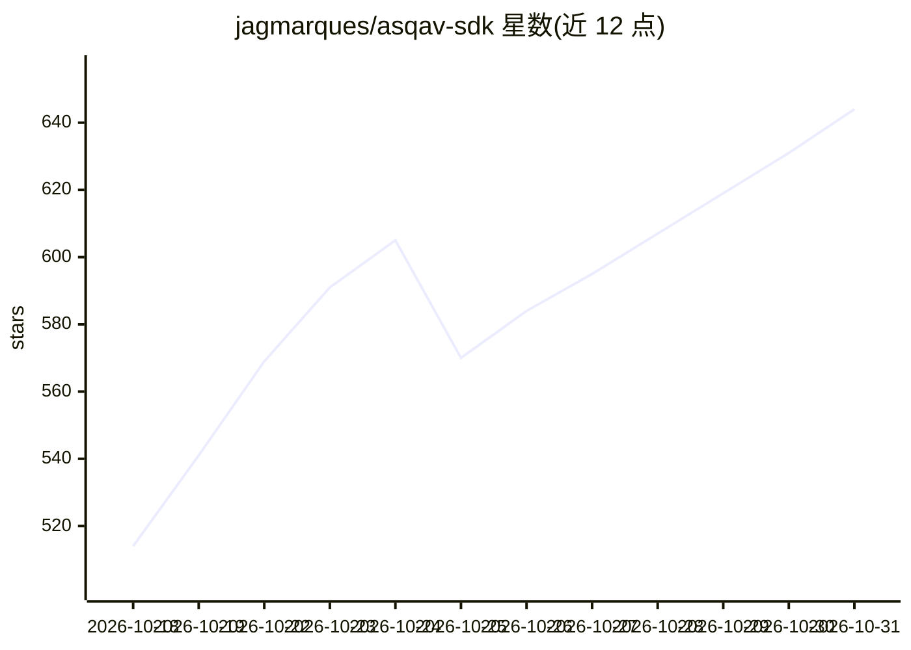

# jagmarques/asqav-sdk

⭐ 644 · Python · NOASSERTION · 推送 2026-10-30 · [GitHub](https://github.com/jagmarques/asqav-sdk) · [官网](https://asqav.com) · 组织维护

**为 AI agent 行为签发可验证合规回执的 Python/TS SDK**

asqav.com 的 Python 与 TypeScript 客户端 SDK：为 agent 每个动作签发 ML-DSA-65（FIPS 204 后量子）签名、哈希链式的时间戳合规回执，可被任何人离线验证且无需账号。支持 agent 间交接互签与回执绑定校验，通过适配器接入 LangChain、CrewAI、smolagents 等约 30 个框架（分为 harness_enforced/framework_callback/in_path_proxy/passive 四类覆盖）。SDK 无原生依赖，密码学在服务端运行；签名服务为商用订阅（Free/Pro/Enterprise），SDK 采用 Elastic License 2.0，验证器为 Apache-2.0。

## 筛选速览

| 维度 | 判定 | 备注 |
|---|---|---|
| AI 角色 | `ai-ecosystem` | LLM/agent 周边工具 |
| 许可风险 | `none` | NOASSERTION |
| 部署形态 | `library` | 以包/库形式分发 |
| 模型依赖 | — | README 未给出锁定关系 |
| 硬件要求 | — | 无带数字的原话,不猜 |
| 安装摩擦 | `low` | 无编译、无系统依赖或容器化 |
| 成熟度 | — | 结构信号不足 |

## 能力要点

- ML-DSA-65（FIPS 204）签名、哈希链式合规回执，支持离线零信任验证
- agent 间交接双向签收与 counterparty_binding 字节绑定校验
- 约 30 个框架适配器并按覆盖类别/执法强度分级
- Python 与 TypeScript 双 SDK 共享一致性测试夹具，无原生依赖

## 适用场景

- 为生产环境 AI agent 的关键动作留存可审计的签名证据
- 让审计方、交易对手或监管方在无账号情况下核验 agent 行为
- agent 间调用时校验对方回执并签发确认

## 场景标签

`LLM 可观测性` · 领域:评测与运维

## 证据(README 行号)

> L6: Client SDKs for asqav.com, the evidence layer for AI agents.
> L12: Source-available client SDK under Elastic License 2.0; open verifier and conformance vectors under Apache-2.0; comm

## 星数曲线

2026-10-18 514 → 2026-10-31 644（+130）

---
*卡片 v1 · prompt 1.4 · 生成 2026-10-21 · 置信度 high · 依据 README sha `17672e2ee0cf` · [字段定义](../../DATASET.md)*
