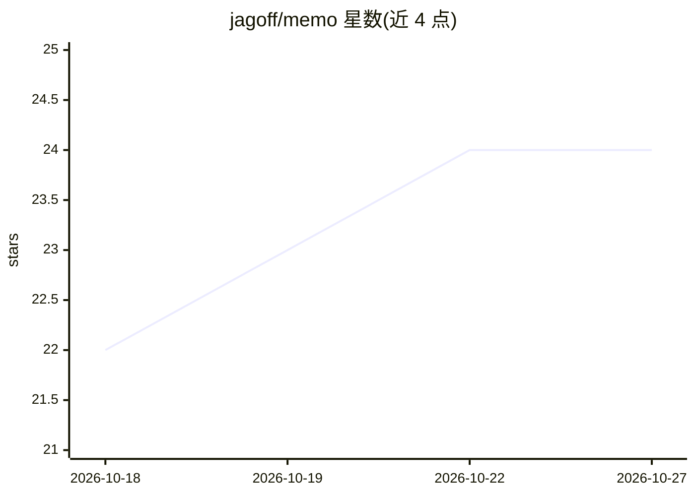

# jagoff/memo

⭐ 24 · Python · MIT · 推送 2026-10-26 · [GitHub](https://github.com/jagoff/memo) · [官网](https://memo-web-sigma.vercel.app) · 个人维护

**给编码 agent 用的本地持久记忆：MCP 服务，Markdown 为真源**

面向 Claude Code、Codex、Cursor、Cline 等编码 agent 及任意 MCP 客户端的本地持久记忆服务：以 Markdown 文件为真源、SQLite 为可重建索引，混合检索（Apple Silicon 用 MLX 向量 + FTS5 BM25，RRF 融合后可 MLX 重排），并含时间机器（按日期重建历史）、矛盾检测与分诊、夜间 7 阶段自优化管线（memo dream）。默认 MCP 43 个工具约 9.7k schema tokens，提供多档 profile；通过安装脚本、uv/pipx/brew 或 Docker 安装，首次拉取约 8 GB 模型；Intel Mac 不支持。

## 筛选速览

| 维度 | 判定 | 备注 |
|---|---|---|
| AI 角色 | `ai-ecosystem` | LLM/agent 周边工具 |
| 许可风险 | `permissive` | MIT |
| 部署形态 | `self-host` | docker 或自建部署 |
| 模型依赖 | — | README 未给出锁定关系 |
| 硬件要求 | — | 无带数字的原话,不猜 |
| 安装摩擦 | `low` | 无编译、无系统依赖或容器化 |
| 成熟度 | — | 结构信号不足 |

## 能力要点

- Markdown 为真源，SQLite 索引可随时从文件重建，可 Obsidian 手改
- 时间机器：按日期逆放 history.db 重建历史状态并 diff
- 矛盾雷达：全库扫描冲突事实并分诊（fuse/newer-wins/dismiss）
- 夜间自优化管线 dream：清点→挖掘→冲突→剪枝→综合→优化→预热向量

## 适用场景

- 让我的编码 agent 跨会话记住项目决策与偏好
- 追溯过去某个时间点的知识状态，理解当时为何这样决定
- 决策变更后自动发现并清理过时记忆
- 不想上云、不想跑向量数据库的本地记忆方案

## 场景标签

`Agent 记忆` · 领域:Agent 开发

## 证据(README 行号)

> L7: Persistent, searchable memory for Claude Code, Codex, Cursor, Cline, Devin, and OpenCode. No cloud, no API keys, no 
> L109: **Hybrid retrieval.** A vector leg (MLX on Apple Silicon, `sentence-transformers` on CPU) and a BM25 leg (FTS5, di
> L117: Also in the box: cross-agent `memo resume` (reopen any session from any agent), cross-Mac git sync, a knowledge gr

## 星数曲线

2026-10-18 22 → 2026-10-27 24（+2）

---
*卡片 v1 · prompt 1.4 · 生成 2026-10-27 · 置信度 high · 依据 README sha `a79a5ab21cf4` · [字段定义](../../DATASET.md)*
