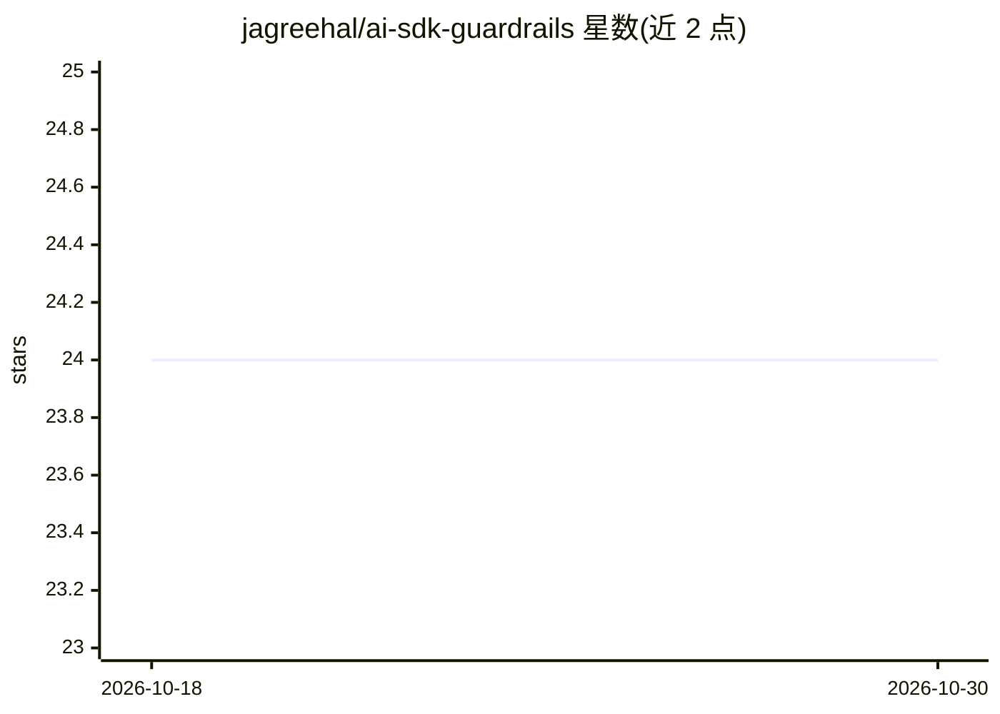

# jagreehal/ai-sdk-guardrails

⭐ 24 · TypeScript · MIT · 推送 2026-09-20 · [GitHub](https://github.com/jagreehal/ai-sdk-guardrails) · [官网](https://www.npmjs.com/package/ai-sdk-guardrails) · 个人维护

**给 Vercel AI SDK 应用加安全与质量中间件的库**

AI SDK Guardrails 是一个为 Vercel AI SDK 提供输入/输出安全控制中间件的开源 TypeScript 库，通过拦截提示词与响应实现安全检查、质量控制和成本管理。以 pnpm monorepo 组织，包含发布到 npm 的核心库、60+ 使用示例、文档站点和交互式护栏配置向导原型。要求 Node.js 22+ 与 pnpm 9+ 开发，MIT 许可，由个人维护者发布。

## 筛选速览

| 维度 | 判定 | 备注 |
|---|---|---|
| AI 角色 | `ai-ecosystem` | LLM/agent 周边工具 |
| 许可风险 | `permissive` | MIT |
| 部署形态 | `library` | 以包/库形式分发 |
| 模型依赖 | — | README 未给出锁定关系 |
| 硬件要求 | — | 无带数字的原话,不猜 |
| 安装摩擦 | `low` | 无编译、无系统依赖或容器化 |
| 成熟度 | — | 结构信号不足 |

## 能力要点

- 拦截提示词与响应的中间件机制
- monorepo 含 60+ 使用示例包
- 附带交互式护栏配置向导原型
- 发布到 npm 并提供类型定义

## 适用场景

- 给基于 Vercel AI SDK 的应用添加输入输出安全检查
- 在 AI 应用中做提示词与响应的质量控制
- 参考示例包学习护栏配置模式

## 场景标签

 · 领域:LLM 基础设施/安全

## 证据(README 行号)

> L3: A monorepo for AI SDK Guardrails - input and output safety controls for the Vercel AI SDK.
> L43: - **ai-sdk-guardrails** - The core library providing guardrails middleware for the Vercel AI SDK

## 星数曲线

2026-10-18 24 → 2026-10-30 24（+0）

---
*卡片 v1 · prompt 1.4 · 生成 2026-10-27 · 置信度 high · 依据 README sha `54e27aa2ca77` · [字段定义](../../DATASET.md)*
