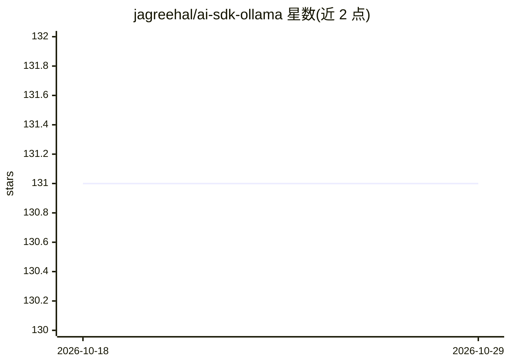

# jagreehal/ai-sdk-ollama

⭐ 131 · TypeScript · MIT · 推送 2026-10-27 · [GitHub](https://github.com/jagreehal/ai-sdk-ollama) · 个人维护

**面向 Vercel AI SDK 的 Ollama 接入 provider 库**

TypeScript 库，基于官方 ollama 包实现，为 Vercel AI SDK 提供 Ollama 模型接入通道，支持跨 provider 使用并暴露 mirostat、num_ctx 等原生参数。提供增强版 generateText/streamText 包装、JSON 级联修复、内置 web search 工具（需 OLLAMA_API_KEY）、嵌入重排序、experimental_decide 决策模型、中间件与 ToolLoopAgent 等功能。通过 npm 安装，要求本地运行 Ollama 与 Node.js 22+，可在 Node.js 与浏览器运行。按 AI SDK 主版本维护多条发布线（4.x/3.x/2.x）。

## 筛选速览

| 维度 | 判定 | 备注 |
|---|---|---|
| AI 角色 | `ai-ecosystem` | LLM/agent 周边工具 |
| 许可风险 | `permissive` | MIT |
| 部署形态 | `library` | 以包/库形式分发 |
| 模型依赖 | local-ok | 支持本地模型 |
| 硬件要求 | — | 无带数字的原话,不猜 |
| 安装摩擦 | `low` | 无编译、无系统依赖或容器化 |
| 成熟度 | — | 结构信号不足 |

## 能力要点

- 基于官方 ollama 包构建的 AI SDK provider，暴露 mirostat/num_ctx 等原生参数
- 增强版 generateText/streamText 包装与 JSON 级联修复
- 内置 web search/fetch 工具与嵌入重排序
- 支持 MCP 集成、中间件系统与 ToolLoopAgent

## 适用场景

- 在 Vercel AI SDK 应用中调用本地 Ollama 模型
- 构建带工具调用与结构化输出的 RAG/Agent 流程
- 在浏览器端直接连接 Ollama 生成文本

## 场景标签

`模型网关` · 领域:Agent 开发

## 证据(README 行号)

> L8: A Vercel AI SDK provider for Ollama, built on the official `ollama` package. Type-safe, cross-provider compatible, w
> L33: import { ollama } from 'ai-sdk-ollama';
> L107: import { generateText, streamText, Output, embed, tool } from 'ai';

## 星数曲线

2026-10-18 131 → 2026-10-29 131（+0）

---
*卡片 v1 · prompt 1.4 · 生成 2026-10-22 · 置信度 high · 依据 README sha `678747de0f0b` · [字段定义](../../DATASET.md)*
