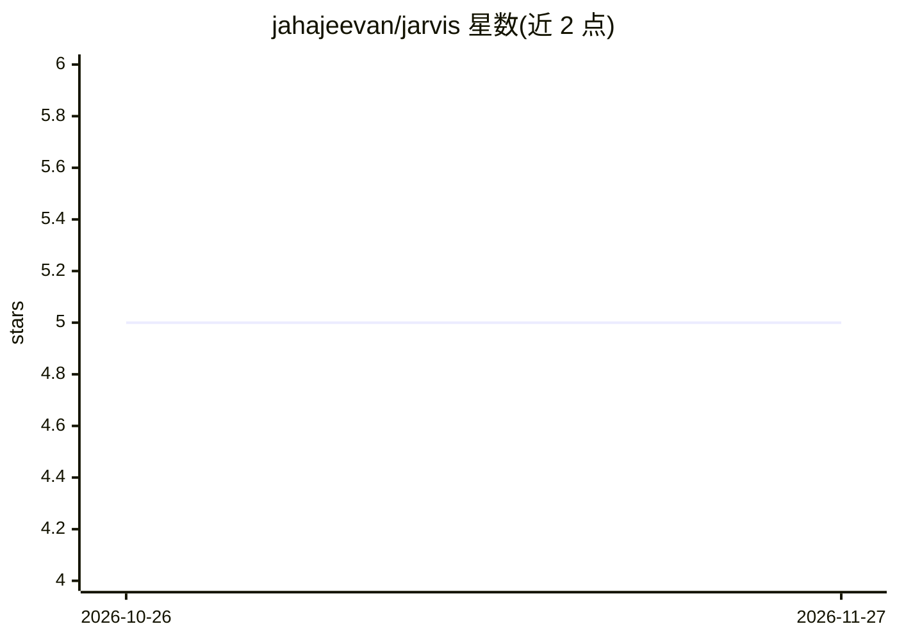

# jahajeevan/jarvis

⭐ 5 · TypeScript · MIT · 推送 2026-10-26 · [GitHub](https://github.com/jahajeevan/jarvis) · 个人维护

**macOS 本地优先的桌面语音助手，数据留在本机**

面向 macOS 用户的本地桌面助手：默认以 Ollama 运行 qwen3:8b 作为本地大脑，配合本地 Whisper 语音转文本与本地/浏览器 TTS 回答；支持显式保存的私有本地记忆、摄像头手势控制 3D 界面、语音打开/退出应用、读取日历与提醒、从未读邮件生成简报。有影响的操作默认关闭（只读模式），可选 NVIDIA 云端大脑（默认关闭）。可从源码运行或打包为 .app/DMG。

## 筛选速览

| 维度 | 判定 | 备注 |
|---|---|---|
| AI 角色 | `ai-native` | 本体是模型或模型工具 |
| 许可风险 | `permissive` | MIT |
| 部署形态 | `library` | 以包/库形式分发 |
| 模型依赖 | local-ok | 支持本地模型 |
| 硬件要求 | — | 无带数字的原话,不猜 |
| 安装摩擦 | `medium` | 含编译或系统依赖之一 |
| 成熟度 | — | 结构信号不足 |

## 能力要点

- 本地 Ollama 大脑（默认 qwen3:8b）+ 本地 Whisper 语音转写与 TTS
- 摄像头手势控制实时 3D Arc 界面（张手校准、捏合脉冲）
- 语音控制：打开/退出应用、日历、提醒、邮件简报
- 只读默认模式，有影响操作需显式开启 JARVIS_ALLOW_WRITES=1

## 适用场景

- 在 Mac 上通过语音与本地模型对话完成日常任务
- 隐私优先场景下把对话与设备数据保留在本机
- 用手势与键盘实时操控 3D 界面做演示
- 用语音管理日历、提醒与未读邮件摘要

## 场景标签

`AI 助手` `语音 Agent` · 领域:对话与助手

## 证据(README 行号)

> L9: JARVIS combines a reactive holographic interface with a local Qwen model, offline speech-to-text, optional local neu
> L33: - Run a local Ollama brain (default: `qwen3:8b`)

## 星数曲线

2026-10-26 5 → 2026-11-27 5（+0）

---
*卡片 v1 · prompt 1.4 · 生成 2026-11-21 · 置信度 high · 依据 README sha `39bbd81c9044` · [字段定义](../../DATASET.md)*
