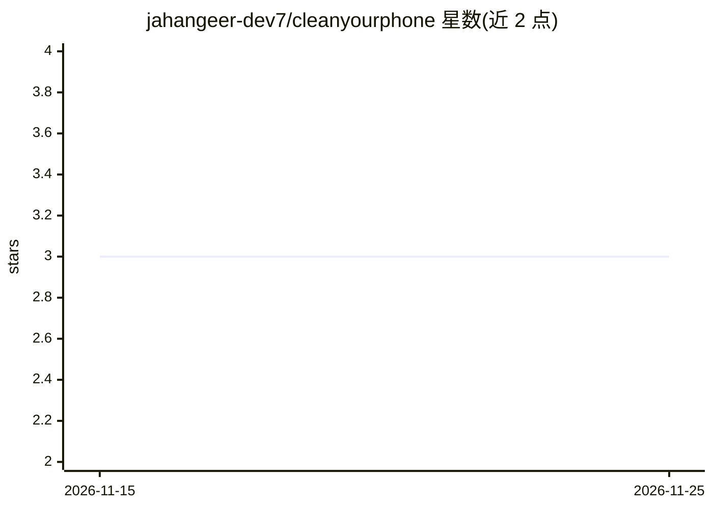

# jahangeer-dev7/cleanyourphone

⭐ 3 · Python · 推送 2026-10-26 · [GitHub](https://github.com/jahangeer-dev7/cleanyourphone) · 个人维护

**用 AI 编码代理通过 ADB 冻结 Android 预装软件的工具集**

一组通过 USB 或无线 ADB 操作 Android 设备的脚本与厂商预装软件配置清单（profiles/），覆盖 Samsung、Xiaomi、Realme/Oppo/OnePlus、Vivo、Transsion、Motorola 等品牌的广告、遥测与虚假清理类包。设计上交由 AI 编码代理（Claude Code、Codex、Cursor、Gemini CLI）按 AGENTS.md 的规则以对话方式执行，也可手动运行 CLI（Option B）。安全机制包括仅用 pm disable-user 冻结而非卸载、硬编码禁止禁用通话/相机/生物识别等组件、提供 restore.sh 一键恢复。MIT 许可。

## 筛选速览

| 维度 | 判定 | 备注 |
|---|---|---|
| AI 角色 | `ai-enhanced` | 去掉 AI 部分产品仍成立 |
| 许可风险 | `none` | — |
| 部署形态 | `None` |  |
| 模型依赖 | — | README 未给出锁定关系 |
| 硬件要求 | — | 无带数字的原话,不猜 |
| 安装摩擦 | `low` | 无编译、无系统依赖或容器化 |
| 成熟度 | — | 结构信号不足 |

## 能力要点

- 按品牌提供预装软件配置清单（profiles/ 目录，7 类清单）
- 仅用 pm disable-user 冻结包，APK 保留在系统分区，可用 restore.sh 恢复
- 硬编码护栏：禁止禁用通话、紧急 SOS、Keyguard、相机、生物识别
- 支持 Android 11+ 无线 ADB 配对与连接（--pair/--connect）

## 适用场景

- 冻结小米/Samsung 等手机的锁屏广告与推送应用
- 通过对话让 AI 代理审计并清理连接的 Android 手机
- 需要可完全恢复（不卸载 APK）的设备精简

## 场景标签

 · 领域:Android 设备工具/系统精简

## 证据(README 行号)

> L5:  The open-source, AI agent-driven Android phone transformation engine.
> L6:  Turn your AI coding assistant (Claude Code, Codex, Cursor, Gemini CLI) into a personal mobile systems engineer.
> L33: **`cleanyourphone` changes this.** It gives your AI agent an exact, verified systems engineering toolkit to audit, 
> L98: ### Option B: Manual CLI Execution

## 星数曲线

2026-11-15 3 → 2026-11-25 3（+0）

---
*卡片 v1 · prompt 1.4 · 生成 2026-11-21 · 置信度 high · 依据 README sha `1d4f0f29a137` · [字段定义](../../DATASET.md)*
