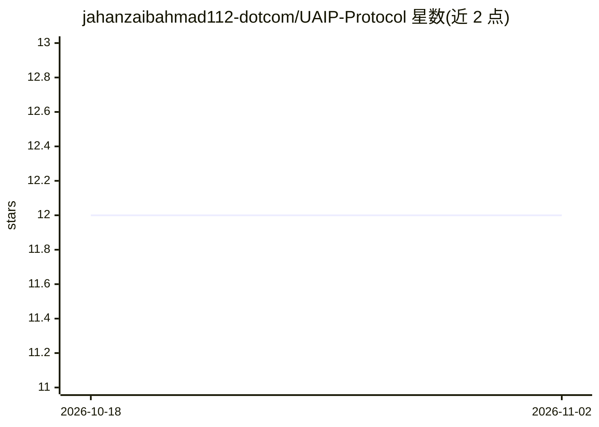

# jahanzaibahmad112-dotcom/UAIP-Protocol

⭐ 12 · Python · NOASSERTION · 推送 2026-01-23 · [GitHub](https://github.com/jahanzaibahmad112-dotcom/UAIP-Protocol) · 个人维护

**AI agent 跨企业安全交易与结算的互操作协议层**

UAIP 是面向自主 AI agent 的安全结算与互操作协议，含 Python SDK 与 FastAPI 网关：为 agent 签发 DID 去中心化身份，通过 Ed25519 签名、Schnorr 零知识证明、nonce/时间戳校验做零信任鉴权；内置 RAG 合规审计（Llama-3-Legal）、关键词阻断与人工审批面板（对标 EU AI Act/SOC2/GDPR/AML），支持 Base/Solana/Ethereum/Polygon 多链 USDC 结算并输出审计日志。区块链结算目前为模拟实现。提供 LangChain/AutoGen/CrewAI 集成示例与 Docker 部署。FSL-1.1 许可，商用托管服务需商业许可，2028 年 1 月起自动转为 Apache 2.0。

## 筛选速览

| 维度 | 判定 | 备注 |
|---|---|---|
| AI 角色 | `ai-ecosystem` | LLM/agent 周边工具 |
| 许可风险 | `none` | NOASSERTION |
| 部署形态 | `None` |  |
| 模型依赖 | — | README 未给出锁定关系 |
| 硬件要求 | — | 无带数字的原话,不猜 |
| 安装摩擦 | `low` | 无编译、无系统依赖或容器化 |
| 成熟度 | — | 结构信号不足 |

## 能力要点

- DID 身份 + Ed25519 签名 + Schnorr 零知识证明的零信任鉴权
- RAG 实时合规审计与人工审批面板（EU AI Act 第 14 条口径）
- 多链 USDC 结算（Base/Solana/Ethereum/Polygon），当前为模拟实现
- 提供 LangChain / AutoGen / CrewAI 集成示例与 Docker 部署

## 适用场景

- 跨企业 agent 之间自动支付与服务结算
- 为高风险 agent 交易接入合规审计与人工审批
- 构建带审计追踪的 agent 任务/赏金市场
- 供应链 agent 自主采购与自动付款

## 场景标签

`Agent 框架` · 领域:Agent 开发

## 证据(README 行号)

> L13: > **Imagine if AI agents could safely transact with each other across companies, with built-in legal compliance and
> L55: ✅ **AI-Powered Compliance** - Real-time legal checks (EU AI Act, SOC2, GDPR)
> L133: |docs/INTEGRATIONS.md|LangChain, AutoGen, CrewAI|You use existing frameworks|

## 星数曲线

2026-10-18 12 → 2026-11-02 12（+0）

---
*卡片 v1 · prompt 1.4 · 生成 2026-11-01 · 置信度 high · 依据 README sha `97395f686687` · [字段定义](../../DATASET.md)*
