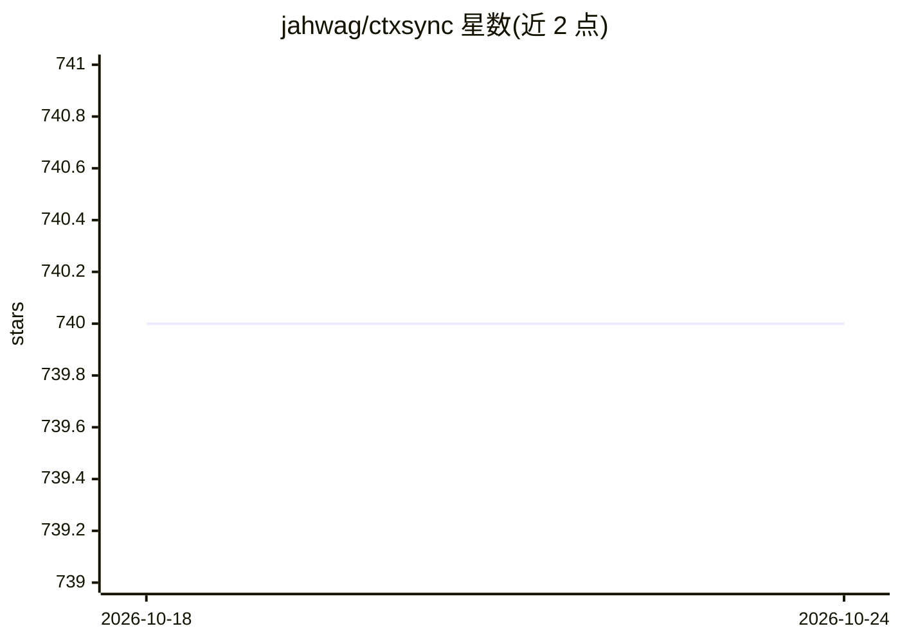

# jahwag/ctxsync

⭐ 740 · Python · MIT · 推送 2026-06-11 · [GitHub](https://github.com/jahwag/ctxsync) · 个人维护

**本地文件与 Claude.ai Projects 自动同步的 Python 工具**

原名 ClaudeSync，pip 安装的命令行工具，通过 ctxsync auth login 认证后把本地文件单向推送到 Claude.ai Projects，支持 Pro/Team 计划（不支持 Free）。本地不存在但远端存在的文件默认会被删除，除非关闭 pruning。要求 Python≥3.10 与 SSH key 存储凭据，跨 Windows/macOS/Linux，可集成到流水线。声明与 Anthropic 无关，用户需自行评估违反 Anthropic 服务条款的风险；旧 claudesync 包已弃用，配置可自动迁移。

## 筛选速览

| 维度 | 判定 | 备注 |
|---|---|---|
| AI 角色 | `ai-ecosystem` | LLM/agent 周边工具 |
| 许可风险 | `permissive` | MIT |
| 部署形态 | `library` | 以包/库形式分发 |
| 模型依赖 | — | README 未给出锁定关系 |
| 硬件要求 | — | 无带数字的原话,不猜 |
| 安装摩擦 | `low` | 无编译、无系统依赖或容器化 |
| 成熟度 | — | 结构信号不足 |

## 能力要点

- 本地文件到 Claude.ai Projects 的单向同步（push）
- 跨 Windows/macOS/Linux，可集成到流水线
- 旧 claudesync 包弃用后配置自动迁移（~/.claudesync）

## 适用场景

- 把本地代码库同步到 Claude.ai 项目中作为上下文
- 在开发流水线中自动更新 Claude.ai 项目的文件
- 需要 Claude Pro/Team 账户配合的同步工作流

## 场景标签

 · 领域:开发者工具/文件同步

## 证据(README 行号)

> L13: ctxsync (formerly known as ClaudeSync) bridges your local development environment with Claude.ai projects, enabling
> L32: - **File sync**: Synchronize local files with Claude.ai projects.

## 星数曲线

2026-10-18 740 → 2026-10-24 740（+0）

---
*卡片 v1 · prompt 1.4 · 生成 2026-10-22 · 置信度 high · 依据 README sha `e1f56d82706c` · [字段定义](../../DATASET.md)*
