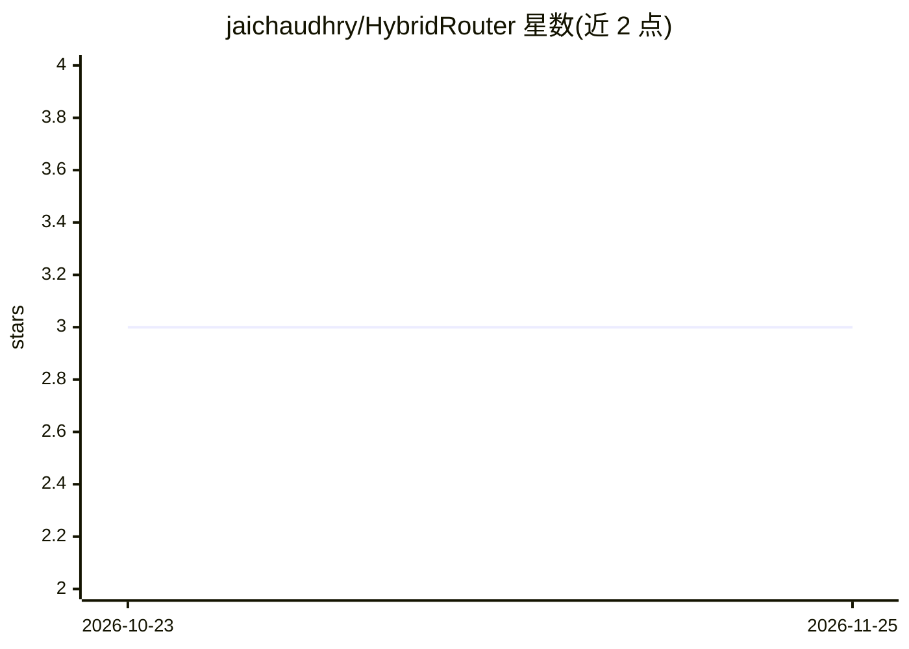

# jaichaudhry/HybridRouter

⭐ 3 · Swift · Apache-2.0 · 推送 2026-11-04 · [GitHub](https://github.com/jaichaudhry/HybridRouter) · 个人维护

**iOS 应用与 Swift 包：按轮次在端侧、Apple 云与 Claude 间路由对话**

由 iOS 应用与 Swift 包（HybridRouterKit）组成：每条消息先经端侧隐私检查与规则判定，再由端侧分类器标注复杂度，路由到 Apple 端侧模型、Apple Private Cloud Compute 或云端模型（Claude/OpenRouter 可选）。三条路由共享同一转录，实现 Apple `LanguageModel` 协议；私密轮次被代码强制不出现在云端模型请求中，并有测试校验。附带基准：150 条保留提示在 Claude Opus 盲评下打分，同时报告成本与端侧占比。运行需 Xcode 27、iOS 27 与支持 Apple Intelligence 的设备；Apple Cloud 权限尚未获批，目前用模拟实现。

## 筛选速览

| 维度 | 判定 | 备注 |
|---|---|---|
| AI 角色 | `ai-ecosystem` | LLM/agent 周边工具 |
| 许可风险 | `permissive` | Apache-2.0 |
| 部署形态 | `None` |  |
| 模型依赖 | locked-api |  |
| 硬件要求 | — | 无带数字的原话,不猜 |
| 安装摩擦 | `low` | 无编译、无系统依赖或容器化 |
| 成熟度 | `idea` | |

## 能力要点

- 每轮对话在端侧、Apple Private Cloud Compute、云端模型三路间路由并共享转录
- 私密轮次在请求层被强制拦截（含重试/升级/会话重建），由测试验证
- 每条回复显示路由、理由、速度与成本；基准同时衡量答案质量与成本
- HybridRouterKitVoice 提供端侧语音转写，音频不出手机

## 适用场景

- 在 iPhone 上混合使用端侧模型与云端模型以控制 API 成本
- 让含敏感信息的轮次不发送到第三方云端模型
- 在自己的 iOS 应用中集成带隐私检查与降级重试的模型路由

## 场景标签

`模型网关` · 领域:Agent 开发

## 证据(README 行号)

> L22: - **One conversation, three models.** Apple's on-device model, Apple Private Cloud Compute and a cloud model (Claud
> L57: 3. **The on-device classifier** labels everything else simple, moderate or complex, which maps to on-device, Apple 
> L77: .package(url: "https://github.com/jaichaudhry/HybridRouter", from: "0.11.0")

## 星数曲线

2026-10-23 3 → 2026-11-25 3（+0）

---
*卡片 v1 · prompt 1.4 · 生成 2026-11-21 · 置信度 high · 依据 README sha `f44a9ef6a2a9` · [字段定义](../../DATASET.md)*
