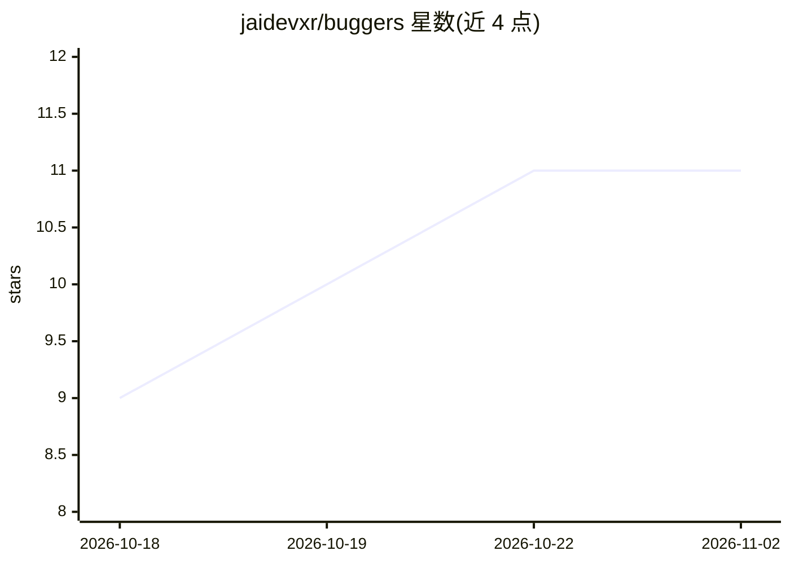

# jaidevxr/buggers

⭐ 11 · TypeScript · NOASSERTION · 推送 2026-10-22 · [GitHub](https://github.com/jaidevxr/buggers) · [官网](https://buggers.dev) · 组织维护

**基于仓库历史的 PR 安全审查与 SAST 漏洞扫描平台**

面向工程团队的 Pull Request 审查工具：结合确定性方法（变更与回滚提交关联、圈复杂度等风险评分、0-100 分制）与多提供商 LLM 回退链（OpenAI/Anthropic/Gemini）生成审查结论，声称修复建议仅引用经核实的 diff 行号。附带高熵正则的密钥扫描、.buggers.yml 阈值质量门禁与 GitHub Check Runs 集成；后端为 Postgres 队列 worker，部署目标 Vercel/Nitro。以源码克隆+npm 安装运行，另有 VS Code 扩展与在线平台。README 标注许可为 Private（All rights reserved）。

## 筛选速览

| 维度 | 判定 | 备注 |
|---|---|---|
| AI 角色 | `ai-enhanced` | 去掉 AI 部分产品仍成立 |
| 许可风险 | `none` | NOASSERTION |
| 部署形态 | `library` | 以包/库形式分发 |
| 模型依赖 | — | README 未给出锁定关系 |
| 硬件要求 | — | 无带数字的原话,不猜 |
| 安装摩擦 | `low` | 无编译、无系统依赖或容器化 |
| 成熟度 | — | 结构信号不足 |

## 能力要点

- 0-100 AST 风险评分（圈复杂度、测试增量、边界变异）
- OpenAI/Anthropic/Gemini 多提供商回退链
- 高熵正则密钥与凭据扫描（云凭据/JWT/API token）
- .buggers.yml 声明式阈值规则经 GitHub Check Runs 强制执行

## 适用场景

- 团队为大型 PR 做自动化安全审查与分流
- 在合并前拦截暴露的密钥与凭据
- 按风险阈值配置合并质量门禁

## 场景标签

`代码审查` `网络安全` · 领域:编码与开发

## 证据(README 行号)

> L22: - **Deterministic Churn Evaluation:** Correlates changed functions with past rollback commits and defect density.
> L28: - **AST-Grounded Risk Scoring:** Deterministic 0–100 risk score weighing cyclomatic complexity, test delta, and bou
> L32: - **Real-Time SAST & Secret Scanning:** High-entropy regex and heuristic detection for exposed cloud credentials, J

## 星数曲线

2026-10-18 9 → 2026-11-02 11（+2）

---
*卡片 v1 · prompt 1.4 · 生成 2026-11-02 · 置信度 mid · 依据 README sha `d059a642abf1` · [字段定义](../../DATASET.md)*
