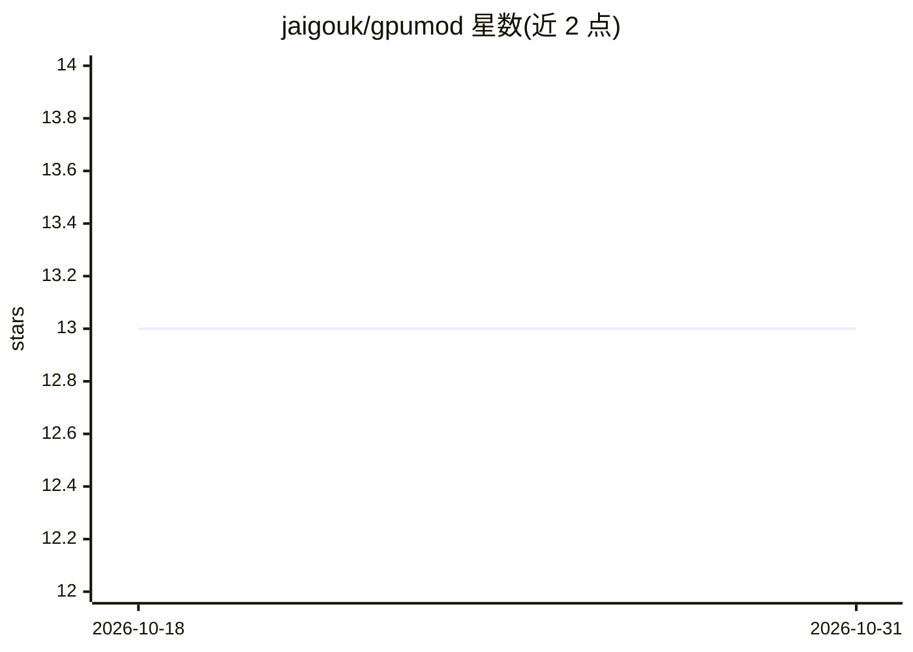

# jaigouk/gpumod

⭐ 13 · Python · Apache-2.0 · 推送 2026-06-26 · [GitHub](https://github.com/jaigouk/gpumod) · [官网](http://jaigouk.com/gpumod/) · 个人维护

**Linux/NVIDIA 上 LLM 推理服务的 GPU 管理器**

面向 Linux+NVIDIA 主机的 GPU 服务管理工具：注册、启动、停止和监控 vLLM、llama.cpp、FastAPI 与 Docker 驱动的推理服务，跟踪 VRAM 分配，支持命名模式（如 chat/coding）切换，部署前可做 VRAM 模拟并给出容量超限时的替代建议。模型注册表可从 HuggingFace Hub 或 GGUF 文件读取元数据并估算 VRAM。另提供 MCP 服务器（16 工具/8 资源）供 Claude Code、Cursor 等 AI 助手查询 GPU 状态与切模式，并通过 Jinja2 模板生成 systemd unit。限制：依赖 uv、Python>=3.12、nvidia-smi。

## 筛选速览

| 维度 | 判定 | 备注 |
|---|---|---|
| AI 角色 | `ai-ecosystem` | LLM/agent 周边工具 |
| 许可风险 | `permissive` | Apache-2.0 |
| 部署形态 | `None` |  |
| 模型依赖 | local-ok | 支持本地模型 |
| 硬件要求 | — | 无带数字的原话,不猜 |
| 安装摩擦 | `low` | 无编译、无系统依赖或容器化 |
| 成熟度 | — | 结构信号不足 |

## 能力要点

- vLLM/llama.cpp/FastAPI/Docker 四种驱动的服务注册与管理
- 部署前 VRAM 模拟与超容量替代建议，模型自动 VRAM 估算
- MCP 服务器（16 工具/8 资源）接入 Claude Code/Cursor/Claude Desktop
- Jinja2 模板生成 systemd unit，含 OOM 保护与 sysctl 预检（doctor 命令）

## 适用场景

- 在单卡上按 chat/coding 等模式切换运行的 LLM 服务组合
- 部署前模拟 VRAM 占用避免超载
- 让 AI 助手通过 MCP 查询 GPU 状态并代为切换模式

## 场景标签

`推理引擎` `MLOps` · 领域:训练与推理

## 证据(README 行号)

> L5: gpumod manages vLLM, llama.cpp, FastAPI, and Docker-based inference services on
> L20: - **MCP Server** -- Expose GPU management as an MCP server for Claude Code,

## 星数曲线

2026-10-18 13 → 2026-10-31 13（+0）

---
*卡片 v1 · prompt 1.4 · 生成 2026-10-31 · 置信度 high · 依据 README sha `3dd87ee68b04` · [字段定义](../../DATASET.md)*
