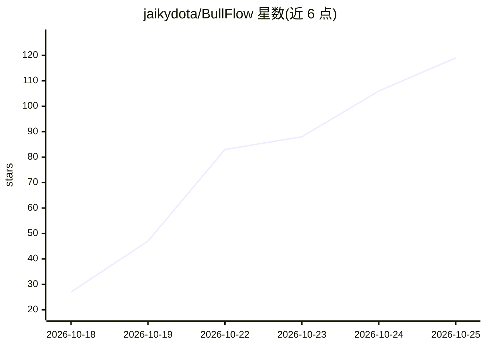

# jaikydota/BullFlow

⭐ 119 · TypeScript · MIT · 推送 2026-10-14 · [GitHub](https://github.com/jaikydota/BullFlow) · 组织维护 · 中文 README

**开源企业级 RAG 平台：知识库驱动 AI 内容创作与 17 平台分发**

面向企业营销场景的一体化系统：将公司/品牌/产品等档案与 12 种格式文档沉淀为知识库，通过 Milvus 向量 + Elasticsearch IK 分词混合检索（RRF 融合、可选 BGE-Reranker 重排），由 LangGraph ReAct Agent 生成文章、图文、图片、视频，再经独立分发网关一键发布到国内外 17 个社媒平台。RAG 链路全用开源本地模型（PaddleOCR、BGE-M3、wtpsplit、OpenCLIP、WhisperX），仅内容生成调用 OpenAI 兼容 API。限制：分发功能依赖第三方服务（灵径/Composio），需自行部署 MySQL/Redis/ES/Milvus 等组件。

## 筛选速览

| 维度 | 判定 | 备注 |
|---|---|---|
| AI 角色 | `ai-native` | 本体是模型或模型工具 |
| 许可风险 | `permissive` | MIT |
| 部署形态 | `self-host` | docker 或自建部署 |
| 模型依赖 | — | README 未给出锁定关系 |
| 硬件要求 | — | 无带数字的原话,不猜 |
| 安装摩擦 | `low` | 无编译、无系统依赖或容器化 |
| 成熟度 | — | 结构信号不足 |

## 能力要点

- RAG 全链路本地开源模型（OCR/分句/向量/重排/以文搜图/转录），零调用费
- Milvus + Elasticsearch 混合检索，RRF 融合，附带 Ragas 评测与权重自动调优
- 一份内容分发到国内 11 + 海外 6 共 17 个平台，账号云端托管与 Webhook 结果回流
- 多租户、积分计费、订阅支付、发票、运营后台（6 组 23 菜单）等商用能力已实现

## 适用场景

- 把白皮书、产品文档入库后让 AI 基于真实资料写公众号文章与小红书笔记
- 一次创作同时定时发布到抖音、小红书、公众号、LinkedIn 等多个平台
- MCN/代运营机构按租户隔离管理多客户知识库与账号并对外售卖订阅
- 企业内部知识问答，答案附带引用来源与相关度分数

## 场景标签

`RAG` `知识库管理` `AI 写作` · 领域:内容生成

## 证据(README 行号)

> L20: 推量牛是一套**企业级 RAG 解决方案**：先把企业的公司 / 品牌 / 产品 / 客户 / 案例、文档、图片、音视频沉淀为**专属知识库**，再由 AI Agent 基于这些资产**创作文章、图文、图片、视频**，最后**一键
> L46: - 💸 **RAG 不依赖付费模型，本地免费部署。** 知识库的每一个环节——OCR（PaddleOCR）、语义分句（wtpsplit）、文本向量（BGE-M3）、重排（BGE-Reranker）、以文搜图（OpenCLIP）、语
> L88: 基于 **LangGraph ReAct** 的创作 Agent，逐 token 真流式输出（SSE），一次对话里可以连续完成「检索 → 写作 → 出图 → 导出」：

## 星数曲线

2026-10-18 27 → 2026-10-25 119（+92）

---
*卡片 v1 · prompt 1.4 · 生成 2026-10-23 · 置信度 mid · 依据 README sha `0559009d39f3` · [字段定义](../../DATASET.md)*
