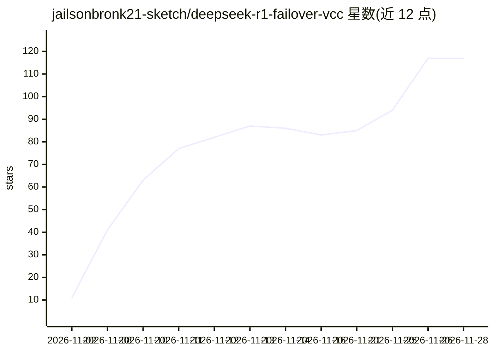

# jailsonbronk21-sketch/deepseek-r1-failover-vcc

⭐ 117 · 推送 2026-10-31 · [GitHub](https://github.com/jailsonbronk21-sketch/deepseek-r1-failover-vcc) · [官网](https://app.coregold.io/signup?invite_code=ADvlj9b) · 个人维护 · 中文 README

**面向 DeepSeek 用户的付费开卡推广页：引导用 CoreGold 虚拟卡充值**

以『DeepSeek-R1 宕机备用指南』为题的推广内容：正文先描述国内卡在 Stripe/AVS 风控下被拒的情形，随后推介 CoreGold 虚拟卡服务（欧美商业级 Visa/Mastercard、USDT 入金、带邀请码的注册链接），并给出登录控制台划转资金的命令示例。仓库不含可安装代码、不含模型调用或切换实现，主题标签含 ustd/vcc，性质为带邀请返利的导流页。

## 筛选速览

| 维度 | 判定 | 备注 |
|---|---|---|
| AI 角色 | `ai-knowledge` | 知识聚合/清单类 |
| 许可风险 | `none` | — |
| 部署形态 | `None` |  |
| 模型依赖 | — | README 未给出锁定关系 |
| 硬件要求 | — | 无带数字的原话,不猜 |
| 安装摩擦 | `low` | 无编译、无系统依赖或容器化 |
| 成熟度 | — | 结构信号不足 |

## 能力要点

- 内容围绕 CoreGold 虚拟卡开卡与 USDT 充值展开，含邀请码链接
- README 提及 Claude 3.7 Sonnet / OpenAI o3-mini 作为 API 备用通道的语境
- 无可安装的故障切换代码或脚本（仅一条打开 URL 的 shell 命令）

## 适用场景

- 无实际可运行的使用场景，仓库为导流/推广页

## 场景标签

 · 领域:支付/推广（非软件）

## 证据(README 行号)

> L2: ⚡ DeepSeek-R1 宕机备用指南：用 CoreGold 1 分钟拉起 Claude / OpenAI 逃生通道
> L9: 国内双币卡被拒，找二手号商不仅价格翻倍，还要承担连坐封号风险。用 **CoreGold** 自己开一张欧美商业级 Visa / Mastercard，USDT 秒级入金，直接打通 API 备用通道。
> L25: open "[https://app.coregold.io/signup?invite_code=ADvlj9b](https://app.coregold.io/signup?invite_code=ADvlj9b)"

## 星数曲线

2026-11-02 11 → 2026-11-28 117（+106）

---
*卡片 v1 · prompt 1.4 · 生成 2026-11-18 · 置信度 high · 依据 README sha `e69fd2e722a1` · [字段定义](../../DATASET.md)*
