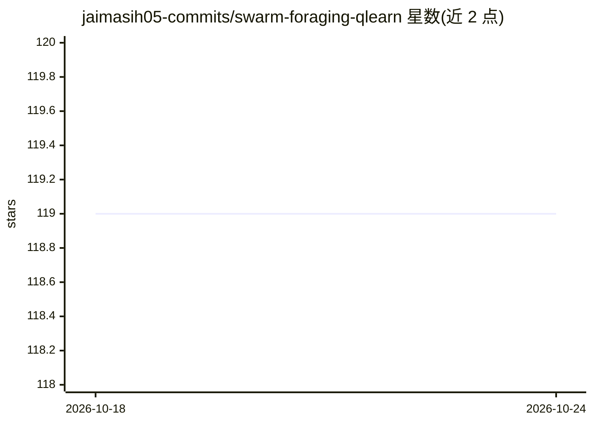

# jaimasih05-commits/swarm-foraging-qlearn

⭐ 119 · HTML · 推送 2026-10-23 · [GitHub](https://github.com/jaimasih05-commits/swarm-foraging-qlearn) · 个人维护

**多智能体 Q-Learning 觅食仿真：网格环境中研究群体涌现行为**

基于纯 NumPy 的分布式 Q-learning 多智能体仿真项目：每个觅食智能体维护独立的状态-动作 Q 表，在动态网格中学习采集可再生资源、规避静/动态障碍并应对资源竞争。环境含资源再生、障碍重配置与可配置奖励（合作/竞争），全部参数经 YAML 配置，无 GPU 与云端依赖，每回合耗时低于 200 毫秒。提供实时渲染面板、实验日志回放、无头连续学习模式与预设实验目录。定位为研究与教育用途的仿真沙盒，README 明确声明不适用于真实自主导航或安全关键场景。

## 筛选速览

| 维度 | 判定 | 备注 |
|---|---|---|
| AI 角色 | `ai-native` | 本体是模型或模型工具 |
| 许可风险 | `none` | — |
| 部署形态 | `None` |  |
| 模型依赖 | — | README 未给出锁定关系 |
| 硬件要求 | `cpu-ok` | |
| 安装摩擦 | `low` | 无编译、无系统依赖或容器化 |
| 成熟度 | — | 结构信号不足 |

## 能力要点

- 不依赖外部 RL 库，纯 NumPy 实现分布式 Q 表与 epsilon-greedy 探索
- 动态可再生资源与移动障碍的环境模型，参数全部经 YAML 配置
- 实时渲染面板、Q 表快照与奖励曲线的时间戳日志及回放
- 无头连续学习模式：每 100 回合自动存档并可断点续跑

## 适用场景

- 研究者原型验证多智能体协调与涌现合作行为
- 开发者学习强化学习在 Python 中的从零实现
- 课堂或自学中观察探索-利用权衡与奖励塑形效果
- 按预设实验目录批量运行并汇总结果到 CSV

## 场景标签

`强化学习` · 领域:训练与推理

## 证据(README 行号)

> L15: - **🧬 Multi-Agent Q-Learning from Scratch**
> L16:  No external RL libraries; agents learn using pure NumPy-based Q-tables, epsilon-greedy exploration, and decaying l
> L7: Unlike traditional multi-agent systems that rely on centralized control or static policies, Synaptic Harmony impleme

## 星数曲线

2026-10-18 119 → 2026-10-24 119（+0）

---
*卡片 v1 · prompt 1.4 · 生成 2026-10-23 · 置信度 high · 依据 README sha `c345a4cd25d2` · [字段定义](../../DATASET.md)*
