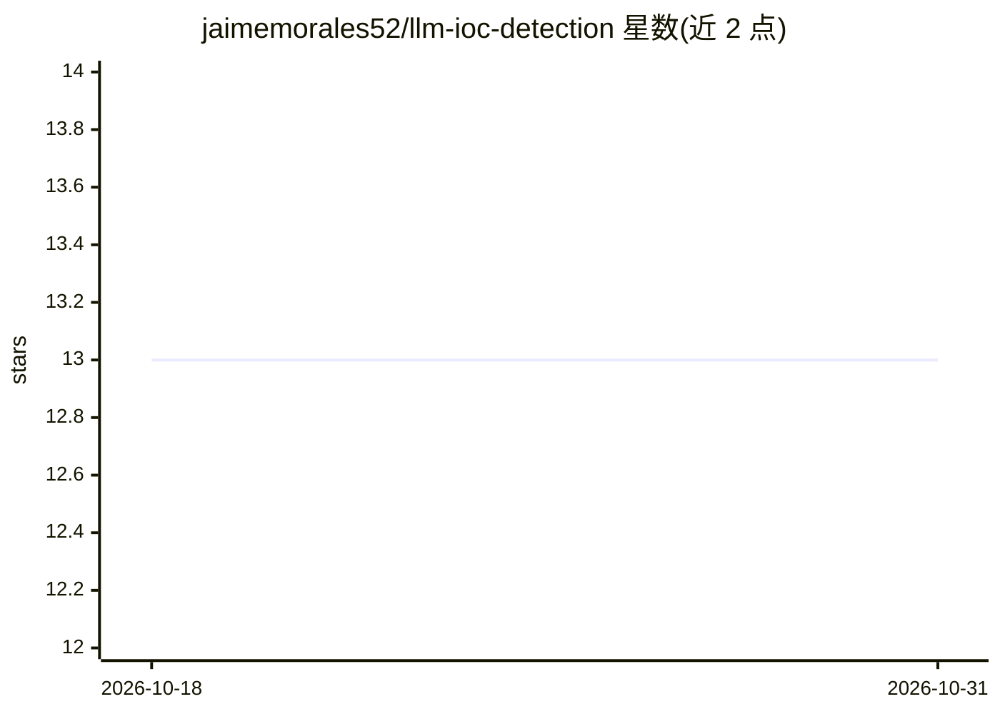

# jaimemorales52/llm-ioc-detection

⭐ 13 · Java · MIT · 推送 2026-03-04 · [GitHub](https://github.com/jaimemorales52/llm-ioc-detection) · 个人维护

**评估多个 LLM 能否检测混淆 JS 代码中隐藏 IoC 的研究后端**

配合论文《Can LLMs Identify Secrets Embedded in Code?》实验的 Spring Boot 后端：在 JavaScript 代码中嵌入 IP 作为秘密，施加可配置的混淆/加密变换（base64、XOR、AES-256、死代码等），再将变体发送给多个 LLM 提供商，返回规范化判定（YES/NO/DON'T_KNOW）与提取出的 IP，并以表格对比各模型各阶段的检出与幻觉情况。面向安全研究人员，通过 REST API 与文件/目录批处理接口使用；README 声明仅限研究与教育用途。

## 筛选速览

| 维度 | 判定 | 备注 |
|---|---|---|
| AI 角色 | `ai-ecosystem` | LLM/agent 周边工具 |
| 许可风险 | `permissive` | MIT |
| 部署形态 | `None` |  |
| 模型依赖 | locked-api |  |
| 硬件要求 | — | 无带数字的原话,不猜 |
| 安装摩擦 | `medium` | 含编译或系统依赖之一 |
| 成熟度 | — | 结构信号不足 |

## 能力要点

- IoC 嵌入 + 多阶段混淆/加密变换的可复现实验流水线
- 对 8 个 LLM 提供商的 API 式访问与响应规范化
- 结果表含 Phase/Contains IP/Is Target IP 等字段，可导出 CSV/XLSX
- 架构预留扩展其他 IoC 类型（域名等）

## 适用场景

- 复现或扩展论文中 LLM 秘密检测实验
- 批量对比不同 LLM 在各混淆阶段下的 IoC 检出率
- 将 LLM IoC 检测接入其他安全工具做脚本化实验

## 场景标签

`网络安全` `模型评测` · 领域:评测与运维

## 证据(README 行号)

> L3: This repository contains the Spring Boot backend used in the experiments of the paper *"Can LLMs Identify Secrets Em
> L136: At a high level, this backend is designed to reproduce the experimental pipeline described in our research:
> L164:  This normalized output can then be exported or post‑processed to compute detection and hallucination metrics, as 

## 星数曲线

2026-10-18 13 → 2026-10-31 13（+0）

---
*卡片 v1 · prompt 1.4 · 生成 2026-10-31 · 置信度 high · 依据 README sha `ef170bdd53bb` · [字段定义](../../DATASET.md)*
