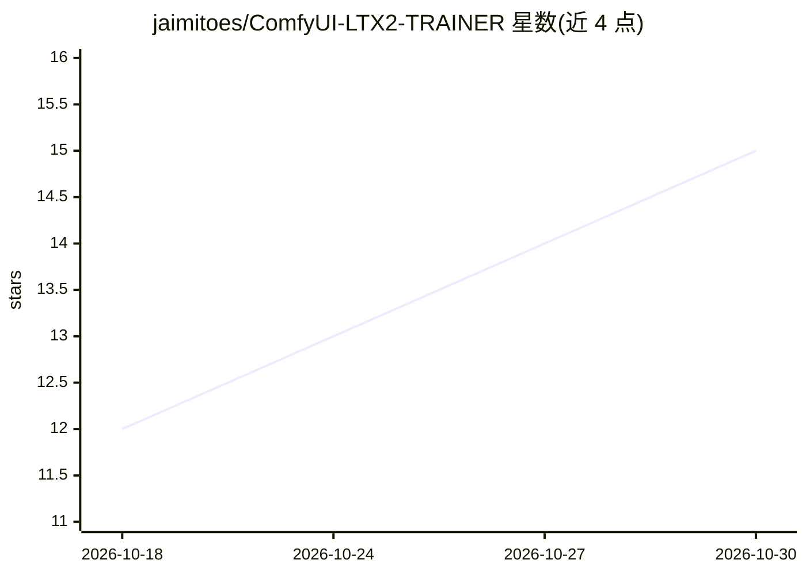

# jaimitoes/ComfyUI-LTX2-TRAINER

⭐ 15 · Python · MIT · 推送 2026-07-13 · [GitHub](https://github.com/jaimitoes/ComfyUI-LTX2-TRAINER) · [官网](https://github.com/Lightricks/LTX-2) · 个人维护

**ComfyUI 内训练 LTX 2.X 视频模型 LoRA 的自定义节点**

将 Lightricks 的 LTX2 训练代码适配为 ComfyUI 自定义节点，支持 LTX 2.0/2.3 的文生视频与视频到视频（Ic-LoRA）LoRA 训练，内置 QwenOmni 或 Qwen3VL 自动打标与转录子图，可一键串联预处理到训练。兼容 12GB VRAM 显卡（需约 96GB 系统内存用于实时量化模型），多 GPU 路径未实测。作者相对官方训练库做了内存管理与重编译次数方面的修改，并给出 Windows 便携版环境下的基准数据。

## 筛选速览

| 维度 | 判定 | 备注 |
|---|---|---|
| AI 角色 | `ai-ecosystem` | LLM/agent 周边工具 |
| 许可风险 | `permissive` | MIT |
| 部署形态 | `library` | 以包/库形式分发 |
| 模型依赖 | — | README 未给出锁定关系 |
| 硬件要求 | `gpu-8g` | |
| 安装摩擦 | `medium` | 含编译或系统依赖之一 |
| 成熟度 | — | 结构信号不足 |

## 能力要点

- 支持 LTX 2.0/2.3 的 TI2V 与 Ic-LoRA 训练
- QwenOmni 或 Qwen3VL 自动生成视频描述与语音转录
- 12GB VRAM 可训练（需约 96GB 系统内存实时量化，或用预量化模型降至 64GB）
- 附带长视频按 bucket 帧长切分的工作流节点

## 适用场景

- 用自己的视频数据集训练 LTX 2 模型的风格或角色 LoRA
- 在低显存（12GB）消费级显卡上完成视频 LoRA 训练
- 在 ComfyUI 内一站式完成打标、切分与训练

## 场景标签

`微调` · 领域:训练与推理

## 证据(README 行号)

> L3: LoRA trainer for LTX 2.X video generation models in ComfyUI
> L49: * LTX 2.0 and LTX 2.3 training.
> L51: * Train TI2V or video to video (Ic-LoRA).

## 星数曲线

2026-10-18 12 → 2026-10-30 15（+3）

---
*卡片 v1 · prompt 1.4 · 生成 2026-10-30 · 置信度 mid · 依据 README sha `cd4508420b58` · [字段定义](../../DATASET.md)*
