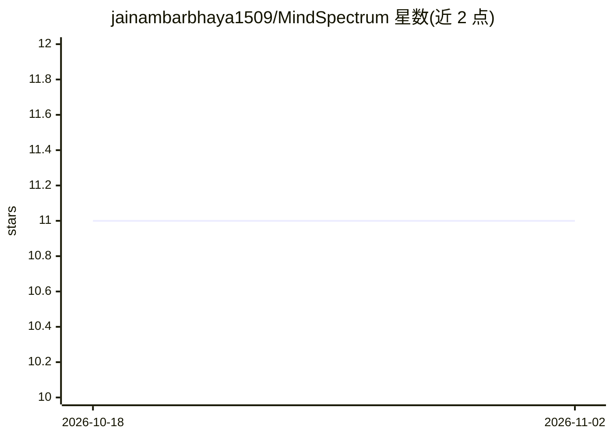

# jainambarbhaya1509/MindSpectrum

⭐ 11 · Jupyter Notebook · MIT · 推送 2026-04-01 · [GitHub](https://github.com/jainambarbhaya1509/MindSpectrum) · 个人维护

**NLP 心理健康状态分类项目**

基于自然语言处理的心理健康分类项目：从社交媒体（Facebook、Twitter）等非临床文本中做推断，识别情绪与可能需要心理援助的人群，README 引用范围综述内容，涉及数据源分类体系、标注与诊断的计算方法，以及生成个性化心理干预的途径。可见 README 仅含项目说明与综述性介绍，未展示安装命令、运行方式或模型细节，仓库带 JupyterLab 主题标签。

## 筛选速览

| 维度 | 判定 | 备注 |
|---|---|---|
| AI 角色 | `ai-native` | 本体是模型或模型工具 |
| 许可风险 | `permissive` | MIT |
| 部署形态 | `None` |  |
| 模型依赖 | — | README 未给出锁定关系 |
| 硬件要求 | — | 无带数字的原话,不猜 |
| 安装摩擦 | `low` | 无编译、无系统依赖或容器化 |
| 成熟度 | — | 结构信号不足 |

## 能力要点

- 从社交媒体等非临床文本推断心理状态
- 涉及情绪检测与心理援助需求识别
- README 引用 NLP 心理健康领域范围综述

## 适用场景

- 分析社交媒体文本以识别情绪状态
- 研究 NLP 在心理健康检测中的应用

## 场景标签

 · 领域:NLP/心理健康计算

## 证据(README 行号)

> L3: ## Natural Language Processing (NLP) techniques can be used to make inferences about people's mental states from wha

## 星数曲线

2026-10-18 11 → 2026-11-02 11（+0）

---
*卡片 v1 · prompt 1.4 · 生成 2026-11-02 · 置信度 low · 依据 README sha `1d50386b3525` · [字段定义](../../DATASET.md)*
