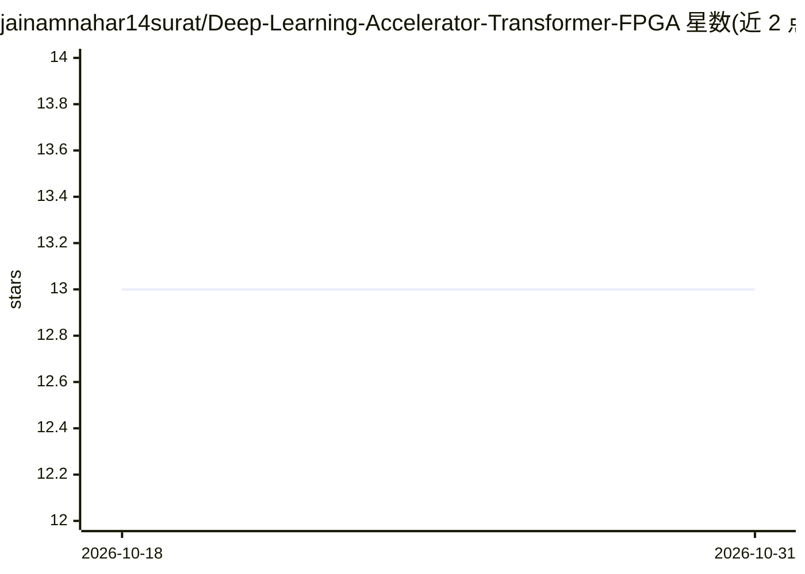

# jainamnahar14surat/Deep-Learning-Accelerator-Transformer-FPGA

⭐ 13 · Verilog · MIT · 推送 2026-02-07 · [GitHub](https://github.com/jainamnahar14surat/Deep-Learning-Accelerator-Transformer-FPGA) · [官网](https://github.com/jainamnahar14surat/Deep-Learning-Accelerator-Transformer-FPGA) · 个人维护

**用 Verilog 在 FPGA 上实现 Transformer 编码器各模块的硬件加速项目**

在 FPGA 上从零实现 Transformer 架构的硬件项目：将位置编码、多头自注意力（含 masked 版本）、前馈网络、层归一化等模块分别用 Verilog 实现，重点在矩阵运算的并行化、流水线与资源优化，以支持边缘设备的实时推理。设计支持注意力头数、模型维度与层数的扩展配置。目前仅覆盖编码器侧，解码器、动态量化与 AXI 接口列为未来工作。面向硬件/嵌入式方向的开发者，需具备 FPGA 开发与 Verilog 工具链背景。

## 筛选速览

| 维度 | 判定 | 备注 |
|---|---|---|
| AI 角色 | `ai-ecosystem` | LLM/agent 周边工具 |
| 许可风险 | `permissive` | MIT |
| 部署形态 | `None` |  |
| 模型依赖 | — | README 未给出锁定关系 |
| 硬件要求 | — | 无带数字的原话,不猜 |
| 安装摩擦 | `low` | 无编译、无系统依赖或容器化 |
| 成熟度 | — | 结构信号不足 |

## 能力要点

- Transformer 各组件以独立 Verilog 模块实现，可分别测试
- 矩阵乘法/点积采用并行 MAC 单元与数据流流水线优化
- 注意力头数、模型维度与层数可配置扩展
- MIT 许可证

## 适用场景

- 在边缘设备上部署低延迟 Transformer 推理硬件
- 学习 Transformer 各模块的硬件化实现方式
- 作为 SoC 集成的 Transformer 硬件 IP 基础（AXI 集成待实现）

## 场景标签

`推理引擎` · 领域:训练与推理

## 证据(README 行号)

> L3: This project implements a **Transformer model** architecture from scratch, directly onto an **FPGA**.
> L38: 6. **Matrix Computations** are heavily optimized using FPGA-specific design patterns (e.g., parallel MAC units, dat

## 星数曲线

2026-10-18 13 → 2026-10-31 13（+0）

---
*卡片 v1 · prompt 1.4 · 生成 2026-10-31 · 置信度 high · 依据 README sha `af19fa1b949e` · [字段定义](../../DATASET.md)*
