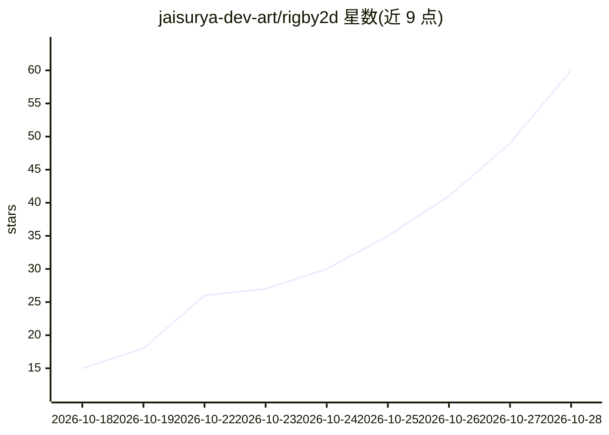

# jaisurya-dev-art/rigby2d

⭐ 68 · JavaScript · Apache-2.0 · 推送 2026-10-28 · [GitHub](https://github.com/jaisurya-dev-art/rigby2d) · [官网](https://jaisurya-dev-art.github.io/rigby2d/) · 组织维护

**开源 2D 骨骼动画编辑器：绑定 PSD/PNG、制作动画、导出运行时，内置 MCP 供 AI 助手操作**

面向游戏、影视与交互体验的开源 2D 骨骼动画工具：导入分层 PSD 或 PNG，用骨骼、网格、约束与皮肤进行绑定，AutoRig 一步从 PSD 生成可编辑骨架并支持动画重定向；Game 与 Film 双工作区，可导出 JSON/.skel + atlas，附带 JavaScript（无依赖）与 Rust 运行时及 Godot 4 节点（预览）。内置 MCP 服务器，AI 助手（如 Claude）可检查、验证、编辑、绑定与转换项目；内置 Python（Pyodide）脚本与自定义工具。基于 Tauri 构建，Windows 提供 MSI/安装包与便携版 exe，macOS/Linux 需从源码构建（Node 20+ 与 Tauri 系统依赖）。自述处于早期 alpha，Unity 运行时在计划中。

## 筛选速览

| 维度 | 判定 | 备注 |
|---|---|---|
| AI 角色 | `ai-enhanced` | 去掉 AI 部分产品仍成立 |
| 许可风险 | `permissive` | Apache-2.0 |
| 部署形态 | `desktop` | 安装包/桌面程序 |
| 模型依赖 | — | README 未给出锁定关系 |
| 硬件要求 | — | 无带数字的原话,不猜 |
| 安装摩擦 | `low` | 无编译、无系统依赖或容器化 |
| 成熟度 | `idea` | |

## 能力要点

- AutoRig 一步绑定分层 PSD（骨骼/关节/网格/IK）与动画重定向
- 内置 MCP 服务器：AI 助手可检查、编辑、绑定与转换项目
- JavaScript（无依赖）/Rust 运行时及 Godot 4 节点（预览）
- 内置 Python 3（Pyodide）脚本，离线可用，可注册为自定义工具

## 适用场景

- 为游戏或交互应用制作 2D 角色骨骼动画并导出到引擎/网页运行
- 制作影视与动态图形动画（PNG 序列/WebM/MP4 渲染、口型同步）
- 让 AI 助手通过 MCP 直接检查与编辑动画项目
- 迁移与转换既有 skeleton JSON/.skel 格式文件

## 场景标签

 · 领域:游戏/动画工具

## 证据(README 行号)

> L3:  Open-source 2D skeletal animation for games, films and interactive experiences.
> L5:  Built-in MCP server: AI assistants can inspect, validate and animate your projects.
> L27: Rigby2D ships a Model Context Protocol server, so assistants such

## 星数曲线

2026-10-18 15 → 2026-10-28 60（+45）

---
*卡片 v1 · prompt 1.4 · 生成 2026-10-25 · 置信度 high · 依据 README sha `11f79b4039f5` · [字段定义](../../DATASET.md)*
