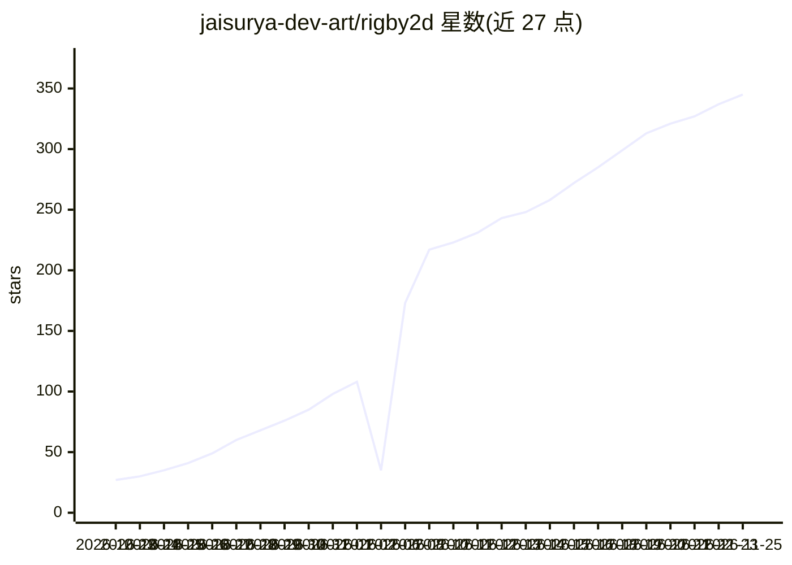

# jaisurya-dev-art/rigby2d

⭐ 345 · JavaScript · Apache-2.0 · 推送 2026-11-23 · [GitHub](https://github.com/jaisurya-dev-art/rigby2d) · [官网](https://rigby2d.com) · 个人维护

**游戏与影视的开源 2D 骨骼动画编辑器，带 MCP 供 AI 操控**

开源 2D 骨骼动画编辑器，覆盖从分层 PSD/SVG/Aseprite 一键 AutoRig、骨骼与网格绑定、IK/物理约束、图编辑器动画，到 4K 影片工作区（含基于本地 Whisper 转写的口型同步）与 GPU 渲染输出。动画以无损 skeleton JSON/二进制 .skel 导出，由 Godot、Unity、Defold、Cocos Creator、Phaser、PixiJS、Ren'Py、JavaScript、Rust 共 9 个开源运行时逐帧播放。内置 MCP 服务器供 Claude 等 AI 助手检查、绑定与动画项目；提供 Python 脚本与 CLI 自动化。桌面版覆盖 Windows/macOS/Linux，亦可浏览器直接运行。

## 筛选速览

| 维度 | 判定 | 备注 |
|---|---|---|
| AI 角色 | `ai-enhanced` | 去掉 AI 部分产品仍成立 |
| 许可风险 | `permissive` | Apache-2.0 |
| 部署形态 | `desktop` | 安装包/桌面程序 |
| 模型依赖 | — | README 未给出锁定关系 |
| 硬件要求 | — | 无带数字的原话,不猜 |
| 安装摩擦 | `low` | 无编译、无系统依赖或容器化 |
| 成熟度 | `idea` | |

## 能力要点

- 分层 PSD/SVG/Aseprite 一键 AutoRig 生成骨骼、关节、网格与 IK
- 9 个开源运行时（Godot/Unity/Defold/Cocos/Phaser/PixiJS/Ren'Py/JS/Rust）逐帧一致播放
- 影片工作区：4K、可动画相机、on-device Whisper 口型同步、GPU 渲染 PNG/WebM/MP4
- 内置 MCP 服务器与 Python 脚本、CLI 自动化（转换、校验、导出、渲染）

## 适用场景

- 为游戏角色制作骨骼动画并导出到 Godot/Unity 等引擎
- 用音频自动生成角色口型同步的动画短片
- 通过 AI 助手（MCP）自动执行绑定与动画任务
- 从 Spine/DragonBones 项目迁移现有动画资产

## 场景标签

 · 领域:游戏/影视动画工具

## 证据(README 行号)

> L5:  Open-source 2D skeletal animation for games and film.
> L100:  **MCP server** so AI assistants such as Claude can inspect, rig and animate your projects.

## 星数曲线

2026-10-23 27 → 2026-11-25 345（+318）

---
*卡片 v1 · prompt 1.4 · 生成 2026-11-25 · 置信度 high · 依据 README sha `bf448a4e42ed` · [字段定义](../../DATASET.md)*
