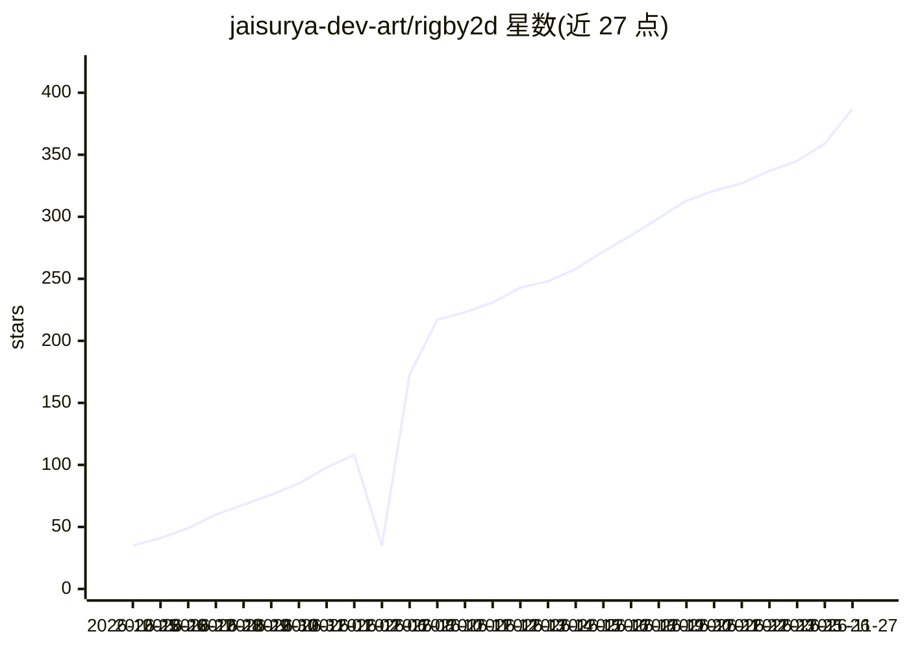

# jaisurya-dev-art/rigby2d

⭐ 387 · JavaScript · Apache-2.0 · 推送 2026-11-26 · [GitHub](https://github.com/jaisurya-dev-art/rigby2d) · [官网](https://rigby2d.com) · 个人维护

**开源 2D 骨骼动画编辑器：为游戏与影视做绑定、动画与导出**

面向游戏与影视从业者的开源 2D 骨骼动画编辑器：分层 PSD/SVG/Aseprite 一键 AutoRig 生成骨骼与网格，支持 IK、物理与路径约束、2.5D 变形器、图编辑器、口型同步与 4K 影片渲染，导出骨架 JSON/.skel、精灵图集。提供 JavaScript/Rust/Godot/Unity 等 9 个运行时。内置 MCP server 供 AI 助手操作项目。桌面版支持 Windows/macOS/Linux，浏览器版无需安装，亦可从源码运行。维护者为一位业余时间开发的个人开发者。

## 筛选速览

| 维度 | 判定 | 备注 |
|---|---|---|
| AI 角色 | `ai-enhanced` | 去掉 AI 部分产品仍成立 |
| 许可风险 | `permissive` | Apache-2.0 |
| 部署形态 | `desktop` | 安装包/桌面程序 |
| 模型依赖 | locked-api |  |
| 硬件要求 | — | 无带数字的原话,不猜 |
| 安装摩擦 | `low` | 无编译、无系统依赖或容器化 |
| 成熟度 | — | 结构信号不足 |

## 能力要点

- 分层 PSD/SVG/Aseprite 一键 AutoRig：骨骼、关节、弯曲网格与 IK
- 9 个开源运行时（JavaScript/Rust/Godot/Unity 等）逐帧一致回放
- 内置 MCP server，AI 助手可检查、绑定与制作动画
- 浏览器版免安装使用，桌面版带签名自动更新

## 适用场景

- 为游戏角色制作骨骼动画并导入游戏引擎
- 从音频生成口型同步的动画短片并渲染成片
- 迁移 Spine 或 DragonBones 的既有项目
- 通过 AI 助手（MCP）自动化绑定与动画流程

## 场景标签

 · 领域:游戏开发/动画工具

## 证据(README 行号)

> L5:  Open-source 2D skeletal animation for games and film.
> L100:  **MCP server** so AI assistants such as Claude can inspect, rig and animate your projects.

## 星数曲线

2026-10-25 35 → 2026-11-27 387（+352）

---
*卡片 v1 · prompt 1.4 · 生成 2026-11-27 · 置信度 high · 依据 README sha `600db179ee13` · [字段定义](../../DATASET.md)*
