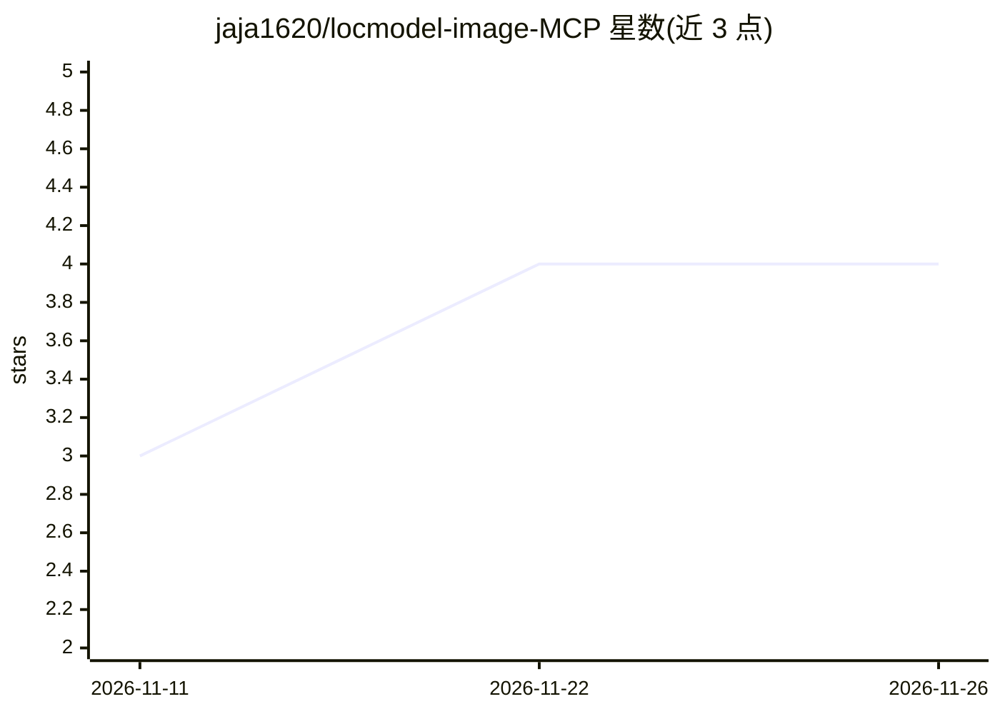

# jaja1620/locmodel-image-MCP

⭐ 4 · Python · MIT · 推送 2026-11-24 · [GitHub](https://github.com/jaja1620/locmodel-image-MCP) · 个人维护 · 中文 README

**把本地 LocModel/stable-diffusion.cpp 图像引擎以 MCP 工具和 CLI 提供给 AI agent 离线调用**

零依赖 Python 桥接层，将 LocModel 桌面应用内置的 sd-server（基于 stable-diffusion.cpp）暴露为 MCP 服务器与 CLI 两种接口，支持文生图、区域重绘与整图重绘。机制包括五层端口自动发现、按总像素面积的 VRAM 守护、跨进程生成锁、失败分类重试与结构化 JSON 输出；掩膜外像素在 CPU 重新合成以保持不变。边界明确：桥接不加载模型、不管理引擎生命周期，需先启动 LocModel 并加载模型。纯标准库实现，无 pip 依赖。

## 筛选速览

| 维度 | 判定 | 备注 |
|---|---|---|
| AI 角色 | `ai-ecosystem` | LLM/agent 周边工具 |
| 许可风险 | `permissive` | MIT |
| 部署形态 | `desktop` | 安装包/桌面程序 |
| 模型依赖 | — | README 未给出锁定关系 |
| 硬件要求 | `gpu-8g` | |
| 安装摩擦 | `low` | 无编译、无系统依赖或容器化 |
| 成熟度 | — | 结构信号不足 |

## 能力要点

- MCP 服务器提供 generate_image/edit_image/redraw_image/load_model 等 9 个工具
- 五层端口发现回退，含解析 sd-server 进程命令行
- CPU 重复合成保证掩膜外像素字节级一致，附 protected_pixels 审计字段
- 附 SKILL.md 提示词技能，指导 agent 写提示词与解读失败

## 适用场景

- 让 Claude Desktop/Cursor 等 MCP 客户端自动生成图片加入工作流
- 脚本/CI 中批量离线生图，无云端无 API key
- 对已有图片按掩膜或色阈重绘指定区域

## 场景标签

`图像生成` · 领域:内容生成

## 证据(README 行号)

> L7: `locmodel-image` is a zero-dependency bridge that exposes the image engine bundled inside
> L13: |**MCP server** (recommended)|`scripts/locmodel_mcp.py` — tools `generate_image`, `locmodel_status`, `list_models`,
> L51: The bridge does **not** load models and does **not** manage the engine lifecycle — start LocModel

## 星数曲线

2026-11-11 3 → 2026-11-26 4（+1）

---
*卡片 v1 · prompt 1.4 · 生成 2026-11-21 · 置信度 high · 依据 README sha `967dfc6752e6` · [字段定义](../../DATASET.md)*
