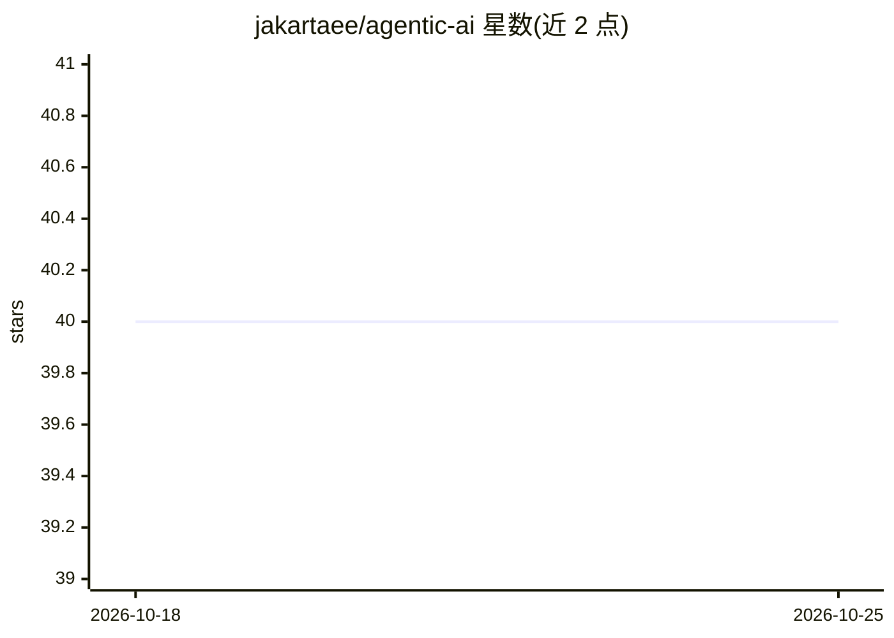

# jakartaee/agentic-ai

⭐ 40 · Java · EPL-2.0 · 推送 2026-10-23 · [GitHub](https://github.com/jakartaee/agentic-ai) · [官网](https://jakartaee.github.io/agentic-ai/) · 组织维护

**Jakarta EE 平台的厂商中立 AI agent 开发规范 API**

Eclipse Jakarta 旗下的规范项目，定义在 Jakarta EE 运行时上构建、部署和运行 AI agent 的厂商中立 API。1.0 提供 @Agent/@Trigger/@Decision/@Action/@Outcome 注解、基于 CDI 事件的触发机制和轻量 LLM 门面，实现层可接入 LangChain4j、Spring AI 等库，unwrap() 可直达底层。工作流在 1.0 同步运行于 Event.fire 线程；目标是 Java SE 17+、Jakarta EE 10+，含 API/spec/TCK/examples 模块，用 Maven 构建。

## 筛选速览

| 维度 | 判定 | 备注 |
|---|---|---|
| AI 角色 | `ai-ecosystem` | LLM/agent 周边工具 |
| 许可风险 | `viral` | EPL-2.0 |
| 部署形态 | `None` |  |
| 模型依赖 | local-ok | 支持本地模型 |
| 硬件要求 | — | 无带数字的原话,不猜 |
| 安装摩擦 | `low` | 无编译、无系统依赖或容器化 |
| 成熟度 | `idea` | |

## 能力要点

- 注解驱动的 agent 定义（@Agent/@Trigger/@Action/@Decision/@Outcome）
- 轻量 LLM 门面，实现可切换（LangChain4j/Spring AI 等），unwrap() 直达底层 API
- 基于 CDI 事件触发与多 agent 协作
- 以 TCK 保证实现的规范兼容性

## 适用场景

- 在 Jakarta EE 运行时上按标准 API 编写可移植的 AI agent
- 需要运行时动态调整 agent 工作流的企业应用
- 通过统一门面切换 LLM 提供商（本地 Ollama 或托管模型）而不改代码

## 场景标签

`多智能体` `Agent 框架` · 领域:Agent 开发

## 证据(README 行号)

> L3: The Jakarta Agentic AI project provides a set of vendor-neutral APIs that make it easy, consistent, and reliable to 
> L14: * Provides a very minimal facade to access more foundational AI capabilities, such as LLMs, without attempting to s

## 星数曲线

2026-10-18 40 → 2026-10-25 40（+0）

---
*卡片 v1 · prompt 1.4 · 生成 2026-10-25 · 置信度 high · 依据 README sha `9565f27bfb01` · [字段定义](../../DATASET.md)*
