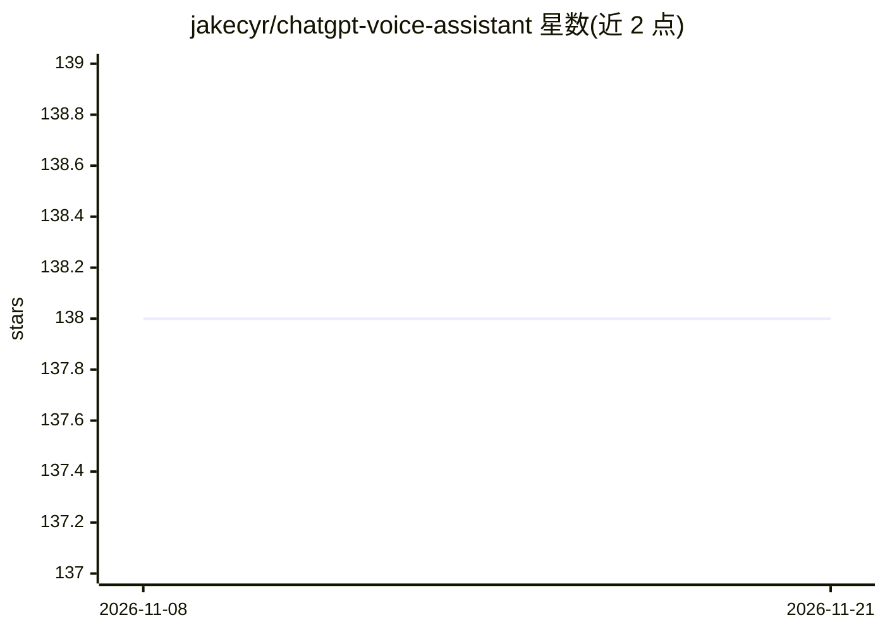

# jakecyr/chatgpt-voice-assistant

⭐ 138 · Python · 推送 2026-11-06 · [GitHub](https://github.com/jakecyr/chatgpt-voice-assistant) · 个人维护

**终端语音助手：麦克风语音经 Whisper 转写并朗读模型回答**

命令行语音对话工具：读取麦克风音频，调用 OpenAI Whisper（whisper-1）转写，经 Chat Completions 生成回答，再用 OpenAI、Apple 或 Google TTS 朗读。默认模型为 gpt-6.1-terra（low reasoning effort），可配置模型、推理力度、token 上限与 TTS 引擎。安装依赖 uv、Git 与 PortAudio（macOS brew / Debian apt），通过 install.sh 脚本以 uv tool 安装，或 git clone 源码运行。API 用量计费，Apple 语音需 macOS，Google 语音需联网。

## 筛选速览

| 维度 | 判定 | 备注 |
|---|---|---|
| AI 角色 | `ai-native` | 本体是模型或模型工具 |
| 许可风险 | `none` | — |
| 部署形态 | `None` |  |
| 模型依赖 | — | README 未给出锁定关系 |
| 硬件要求 | — | 无带数字的原话,不猜 |
| 安装摩擦 | `low` | 无编译、无系统依赖或容器化 |
| 成熟度 | — | 结构信号不足 |

## 能力要点

- Whisper 语音转写 + Chat Completions 生成回答
- 三种 TTS 输出可选：OpenAI / Apple / Google
- install.sh 脚本一键安装 gptassist CLI
- 支持模型、推理力度、token 上限等命令行参数

## 适用场景

- 在终端用语音与 OpenAI 模型对话
- 不想打字时用麦克风提问并获得朗读的回答
- 按偏好切换 OpenAI、Apple 或 Google 语音输出

## 场景标签

`语音 Agent` · 领域:对话与助手

## 证据(README 行号)

> L3: Talk to an OpenAI model using your microphone. Speech is transcribed by OpenAI and the answer is spoken using OpenAI
> L30: The default chat model is `gpt-6.1-terra` with low reasoning effort. The completion token limit includes reasoning 

## 星数曲线

2026-11-08 138 → 2026-11-21 138（+0）

---
*卡片 v1 · prompt 1.4 · 生成 2026-11-17 · 置信度 high · 依据 README sha `d1470fefeff3` · [字段定义](../../DATASET.md)*
