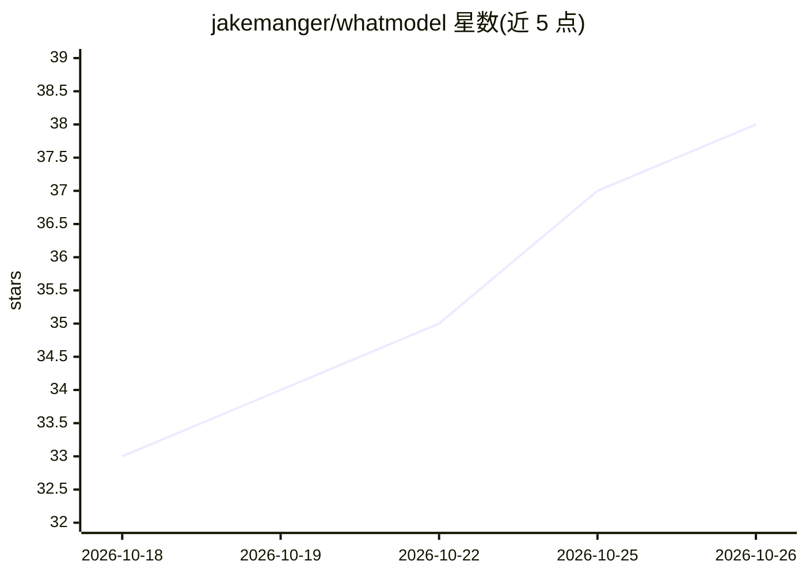

# jakemanger/whatmodel

⭐ 38 · TypeScript · MIT · 推送 2026-10-21 · [GitHub](https://github.com/jakemanger/whatmodel) · [官网](https://whatmodel.sh) · 个人维护

**开放 AI 模型排行榜：按硬件与预算筛出可运行的模型**

whatmodel.sh 的排行榜仓库：收录 885 个模型，以 22,291 条已发表基准测试结果合成的单一分数排名，同时给出价格、所需内存与运行命令。用户可通过 curl 带上本机 RAM/显存参数查询自己机器能跑的模型，或在网站上按预算筛选；README 内以 ASCII 图表展示分数与价格、内存的关系，并附 Top 榜单，覆盖 llm/图像/视频/TTS/STT 五类。

## 筛选速览

| 维度 | 判定 | 备注 |
|---|---|---|
| AI 角色 | `ai-knowledge` | 知识聚合/清单类 |
| 许可风险 | `permissive` | MIT |
| 部署形态 | `desktop` | 安装包/桌面程序 |
| 模型依赖 | — | README 未给出锁定关系 |
| 硬件要求 | — | 无带数字的原话,不猜 |
| 安装摩擦 | `low` | 无编译、无系统依赖或容器化 |
| 成熟度 | — | 结构信号不足 |

## 能力要点

- 885 个模型按 22,291 条基准结果合成的单一分数排名
- 支持按本机 RAM/显存参数过滤可运行模型（curl 命令）
- 提供分数 vs 价格、分数 vs 内存的图表与模型榜单
- 覆盖 llm、图像、视频、TTS、STT 五个类别

## 适用场景

- 查我的电脑内存/显存能跑哪些模型
- 按预算比较各模型的分数与 API 价格
- 了解本地运行某模型所需的内存占用与运行方式

## 场景标签

`模型评测` · 领域:评测与运维

## 证据(README 行号)

> L1: whatmodel.sh: find the best AI models you can run
> L3:  The open AI model leaderboard. Every model is ranked by one score built from 22,291 published benchmark results, wi
> L7: updated 2026-10-21 08:35 UTC · 885 models · scores combine 575 benchmarks · how it works · benchmark your machine · 

## 星数曲线

2026-10-18 33 → 2026-10-26 38（+5）

---
*卡片 v1 · prompt 1.4 · 生成 2026-10-25 · 置信度 high · 依据 README sha `2bbf5d4f238a` · [字段定义](../../DATASET.md)*
