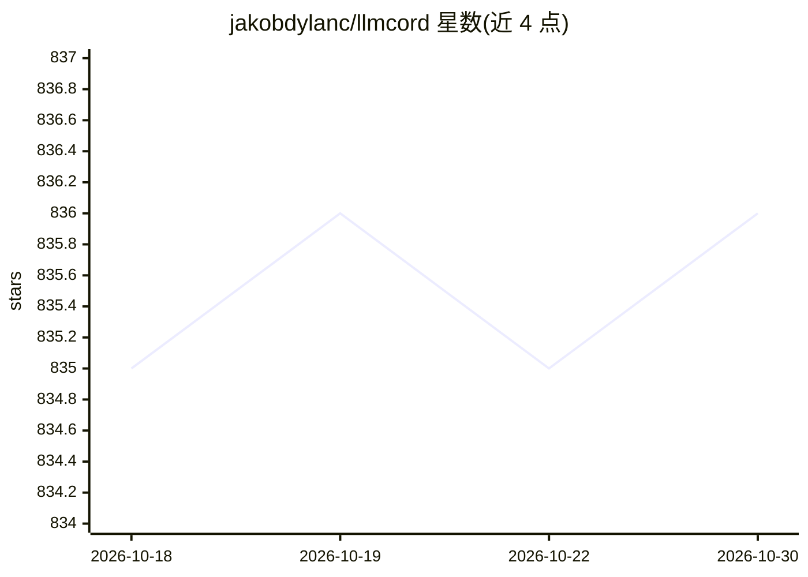

# jakobdylanc/llmcord

⭐ 836 · Python · MIT · 推送 2026-08-14 · [GitHub](https://github.com/jakobdylanc/llmcord) · 个人维护

**把 Discord 变成协作式 LLM 聊天前端的机器人**

单文件 Python 编写的 Discord 机器人，将服务器变成 LLM 群聊界面：@机器人发起对话，回复链即对话历史，全部存储在 Discord 消息中，无需数据库。支持 OpenRouter/OpenAI/xAI/Google 等远程服务及 Ollama/LM Studio/vLLM 本地运行时，任何 OpenAI /v1/chat/completions 兼容 API 均可接入。通过 /model 切换模型，支持视觉模型图片附件、文件附件、流式输出与权限配置。安装方式为 git clone 后 pip 装依赖运行，或 docker compose。

## 筛选速览

| 维度 | 判定 | 备注 |
|---|---|---|
| AI 角色 | `ai-native` | 本体是模型或模型工具 |
| 许可风险 | `permissive` | MIT |
| 部署形态 | `self-host` | docker 或自建部署 |
| 模型依赖 | local-ok | 支持本地模型 |
| 硬件要求 | — | 无带数字的原话,不猜 |
| 安装摩擦 | `low` | 无编译、无系统依赖或容器化 |
| 成熟度 | — | 结构信号不足 |

## 能力要点

- 回复链即对话历史，存储在 Discord 内，无需数据库
- 支持任意 OpenAI /v1/chat/completions 兼容 API（远程或本地）
- /model 命令切换模型，含视觉模型图片附件支持
- 单 Python 文件约 300 行代码，支持 Docker 运行

## 适用场景

- 和朋友在 Discord 服务器里共同与 LLM 对话
- 为社群搭建可切换多种远程/本地模型的聊天机器人
- 通过回复链分支延续多话题讨论

## 场景标签

`聊天机器人` · 领域:对话与助手

## 证据(README 行号)

> L5: llmcord transforms Discord into a collaborative LLM frontend. It works with practically any LLM, remote or locally h
> L33: Or run local models with:

## 星数曲线

2026-10-18 835 → 2026-10-30 836（+1）

---
*卡片 v1 · prompt 1.4 · 生成 2026-10-21 · 置信度 mid · 依据 README sha `f7ba246e85be` · [字段定义](../../DATASET.md)*
