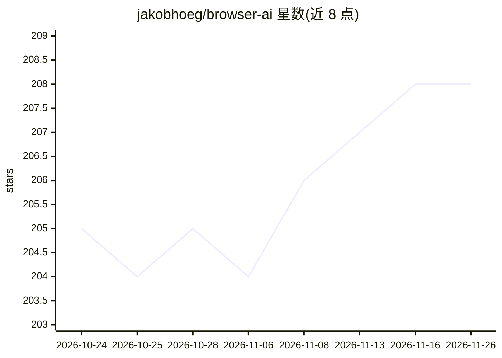

# jakobhoeg/browser-ai

⭐ 208 · TypeScript · NOASSERTION · 推送 2026-11-19 · [GitHub](https://github.com/jakobhoeg/browser-ai) · [官网](https://browser-ai.dev) · 个人维护

**为 Vercel AI SDK 提供浏览器内 AI 模型接入的 provider 库**

TypeScript 库集合，为 Vercel AI SDK 提供浏览器内 AI 模型的 provider 接入，覆盖 Chrome/Edge 内置 AI、WebLLM、Transformers.js、wllama（llama.cpp）四条运行时路径，并提供回退到服务端模型的机制。面向在前端应用中集成客户端 AI 的 Web 开发者，通过 npm 分发多个包，README 附各包与 AI SDK v5/v6/v7 的版本兼容表及示例应用链接。

## 筛选速览

| 维度 | 判定 | 备注 |
|---|---|---|
| AI 角色 | `ai-ecosystem` | LLM/agent 周边工具 |
| 许可风险 | `none` | NOASSERTION |
| 部署形态 | `library` | 以包/库形式分发 |
| 模型依赖 | — | README 未给出锁定关系 |
| 硬件要求 | — | 无带数字的原话,不猜 |
| 安装摩擦 | `low` | 无编译、无系统依赖或容器化 |
| 成熟度 | — | 结构信号不足 |

## 能力要点

- 支持 Chrome/Edge 内置浏览器 AI 模型（@browser-ai/core）
- 支持 WebLLM、Transformers.js、wllama（llama.cpp）三种浏览器内推理运行时
- 可与 Vercel AI SDK v5/v6/v7 配合使用
- 提供浏览器内模型到服务端模型的回退机制

## 适用场景

- 在 Next.js 等前端应用中直接调用浏览器内 LLM 推理
- 浏览器不支持本地模型时回退到服务端模型
- 用统一的 AI SDK 接口适配多家浏览器内推理后端

## 场景标签

`模型网关` · 领域:Agent 开发

## 证据(README 行号)

> L1: # Browser AI model providers for Vercel AI SDK
> L12: TypeScript libraries that provide access to in-browser AI model providers with seamless fallback to using server-si

## 星数曲线

2026-10-24 205 → 2026-11-26 208（+3）

---
*卡片 v1 · prompt 1.4 · 生成 2026-11-25 · 置信度 high · 依据 README sha `d3edaad6ecf5` · [字段定义](../../DATASET.md)*
