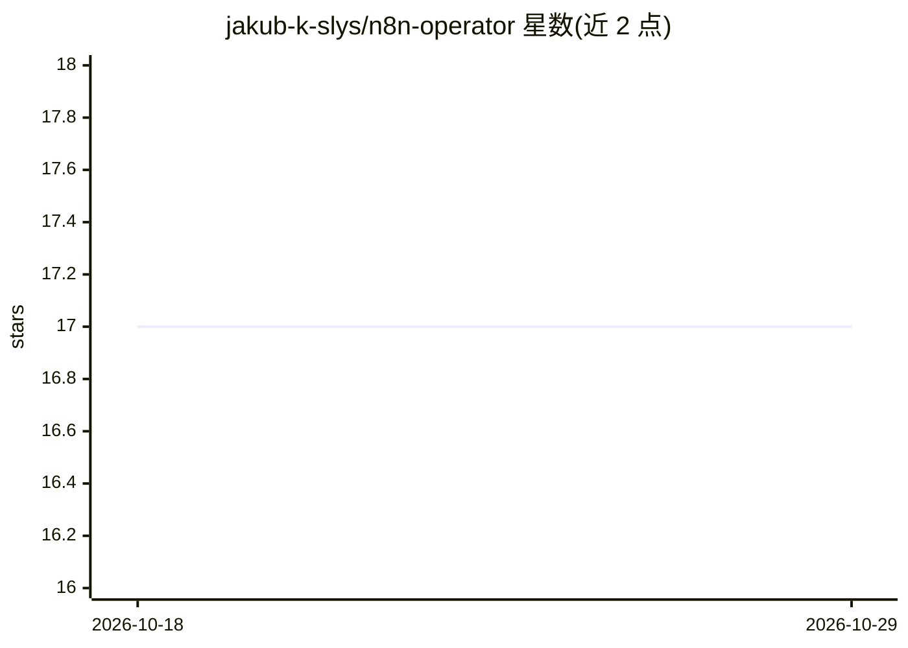

# jakub-k-slys/n8n-operator

⭐ 17 · Go · Apache-2.0 · 推送 2026-06-23 · [GitHub](https://github.com/jakub-k-slys/n8n-operator) · [官网](https://iam.slys.dev) · 个人维护

**在 Kubernetes 上自动部署管理 n8n 实例的 Operator（已停止积极开发）**

基于 Operator SDK 的 Kubernetes Operator，通过自定义资源（N8n CRD）自动化 n8n 工作流自动化平台的部署与管理：支持 PostgreSQL 数据库配置、Ingress 与 Gateway API HTTPRoute 流量路由、持久卷自动供给、非根容器与自动 TLS、Prometheus 指标集成。面向在 Kubernetes 集群中运行 n8n 的运维/开发人员。注意：README 顶部声明本项目不再积极开发，继任项目为 Rust 实现的 N8n Rustful Operator。采用 Apache-2.0 许可。

## 筛选速览

| 维度 | 判定 | 备注 |
|---|---|---|
| AI 角色 | `ai-ecosystem` | LLM/agent 周边工具 |
| 许可风险 | `permissive` | Apache-2.0 |
| 部署形态 | `None` |  |
| 模型依赖 | — | README 未给出锁定关系 |
| 硬件要求 | — | 无带数字的原话,不猜 |
| 安装摩擦 | `low` | 无编译、无系统依赖或容器化 |
| 成熟度 | — | 结构信号不足 |

## 能力要点

- 通过 N8n 自定义资源声明式部署 n8n 实例
- 支持 Ingress 与 Gateway API HTTPRoute 流量路由
- 自动持久卷供给、非根容器执行与自动 TLS
- Prometheus 指标集成

## 适用场景

- 在 Kubernetes 集群中声明式部署 n8n 实例
- 为 n8n 配置 PostgreSQL 数据库与流量入口
- 通过 Prometheus 监控 n8n 运行状态

## 场景标签

 · 领域:DevOps/Kubernetes 运维

## 证据(README 行号)

> L15: A Kubernetes operator that automates the deployment and management of n8n workflow automation instances on Kubernet
> L21: - **Automated Deployment**: Simplified n8n instance deployment with PostgreSQL database configuration

## 星数曲线

2026-10-18 17 → 2026-10-29 17（+0）

---
*卡片 v1 · prompt 1.4 · 生成 2026-10-29 · 置信度 high · 依据 README sha `33700fccf9ba` · [字段定义](../../DATASET.md)*
