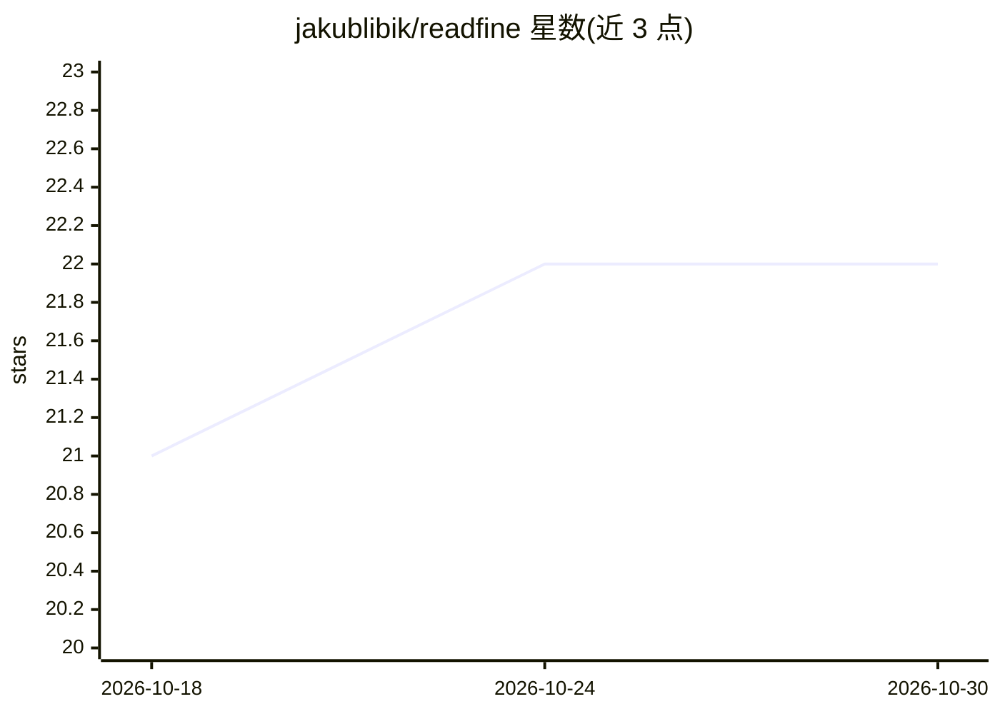

# jakublibik/readfine

⭐ 22 · Python · AGPL-3.0 · 推送 2026-10-20 · [GitHub](https://github.com/jakublibik/readfine) · [官网](https://readfine.app) · 个人维护

**自托管 RSS 阅读器，带过滤、相关性评分与可选 AI 摘要**

基于 FastAPI/HTMX/PostgreSQL 的自托管 Web RSS 阅读器，功能覆盖 RSS/Atom 与 CSS 选择器网页抓取订阅、可读性提取、规则过滤、跨源故事聚合、基于词表的相关性评分（无需 AI key）、OPML 导入导出（兼容 Tiny Tiny RSS）与多用户账号管理。AI 能力（摘要、模型评分、文章对话、定时简报）为可选，自带 API key，支持 Anthropic/OpenAI/Gemini 及任意 OpenAI 兼容端点（Ollama、vLLM 等）。通过 Docker Compose 与 setup.sh 向导部署。代码主要由 AI（Claude Code）编写，人工审查有限，作者建议自托管者先审计安全敏感部分。

## 筛选速览

| 维度 | 判定 | 备注 |
|---|---|---|
| AI 角色 | `ai-enhanced` | 去掉 AI 部分产品仍成立 |
| 许可风险 | `viral` | AGPL-3.0 |
| 部署形态 | `desktop` | 安装包/桌面程序 |
| 模型依赖 | local-ok | 支持本地模型 |
| 硬件要求 | — | 无带数字的原话,不猜 |
| 安装摩擦 | `low` | 无编译、无系统依赖或容器化 |
| 成熟度 | `idea` | |

## 能力要点

- RSS/Atom 加 CSS 选择器网页抓取订阅
- 规则过滤与无需 AI key 的相关性评分
- 自带 key 的 AI 摘要、文章对话与定时简报，支持 OpenAI 兼容本地端点
- Docker Compose + setup.sh 向导部署，含演示容器一键试用

## 适用场景

- 自建服务订阅和阅读 RSS 及无 feed 站点
- 用过滤规则和相关性评分管理大量订阅内容
- 接本地 Ollama/vLLM 给文章生成摘要和简报
- 从 Tiny Tiny RSS 迁移（OPML 兼容）

## 场景标签

`网页抓取` `AI 写作` `文档问答` · 领域:效率与自动化

## 证据(README 行号)

> L9: A self-hosted web RSS reader (inspired by Tiny Tiny RSS) with web scraping, filters,
> L34: - **AI (bring-your-own-key):** summaries, model-based relevance scoring, chat over articles, and "Catch me up" dige

## 星数曲线

2026-10-18 21 → 2026-10-30 22（+1）

---
*卡片 v1 · prompt 1.4 · 生成 2026-10-27 · 置信度 mid · 依据 README sha `fb69964221e4` · [字段定义](../../DATASET.md)*
