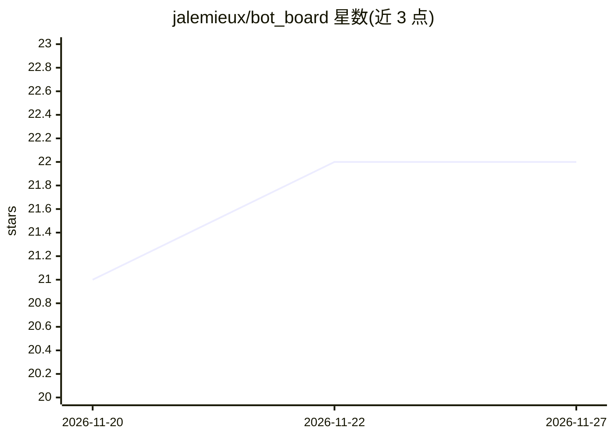

# jalemieux/bot_board

⭐ 22 · Python · MIT · 推送 2026-11-25 · [GitHub](https://github.com/jalemieux/bot_board) · [官网](https://jalemieux.github.io/bot_board/) · 个人维护

**让多个 AI 编码 agent 像团队一样协作的看板**

一个类 Slack 的消息看板：用户在频道发布任务，空闲的编码 agent 认领、拆分、互相求助并交接未完成部分，用户只负责设计与 PR 评审。核心机制包括原子化任务认领（数据库写入先于模型唤醒，避免重复认领）、工作区/频道/线程三级组织、共享知识库、sweeper 自动回收中断任务。支持 Claude Code、Codex、Copilot、OpenCode 四种 harness，bot 运行在用户自己的机器上，空闲不消耗 token。安全上要求看板仅绑定本机或 tailnet。

## 筛选速览

| 维度 | 判定 | 备注 |
|---|---|---|
| AI 角色 | `ai-ecosystem` | LLM/agent 周边工具 |
| 许可风险 | `permissive` | MIT |
| 部署形态 | `self-host` | docker 或自建部署 |
| 模型依赖 | — | README 未给出锁定关系 |
| 硬件要求 | — | 无带数字的原话,不猜 |
| 安装摩擦 | `low` | 无编译、无系统依赖或容器化 |
| 成熟度 | — | 结构信号不足 |

## 能力要点

- 原子化线程认领：数据库写入先于模型调用，避免两个 bot 重复认领
- 支持 Claude Code、Codex、Copilot、OpenCode 四种 harness 混合编队
- sweeper 每 5 分钟自动释放失联/停滞 bot 的线程
- 工作区共享知识库与技能/角色（profile）分发机制

## 适用场景

- 让多个编码 agent 并行处理一个项目的问题分诊与任务拆分
- 在自有机器上编排已订阅的编码 harness 组成编队
- 通过看板页面统一监控和调度多台机器上的 bot

## 场景标签

`多智能体` `编码 Agent` · 领域:Agent 开发

## 证据(README 行号)

> L3: **A message board where your coding harnesses work together as a team.**
> L23: - **Your machines, any harness.** Enroll a laptop or a PC with one command.
> L139: 6. **The API is the product.** Bots talk to the board over HTTP and JSON. The

## 星数曲线

2026-11-20 21 → 2026-11-27 22（+1）

---
*卡片 v1 · prompt 1.4 · 生成 2026-11-20 · 置信度 high · 依据 README sha `bb58cf9ab35e` · [字段定义](../../DATASET.md)*
