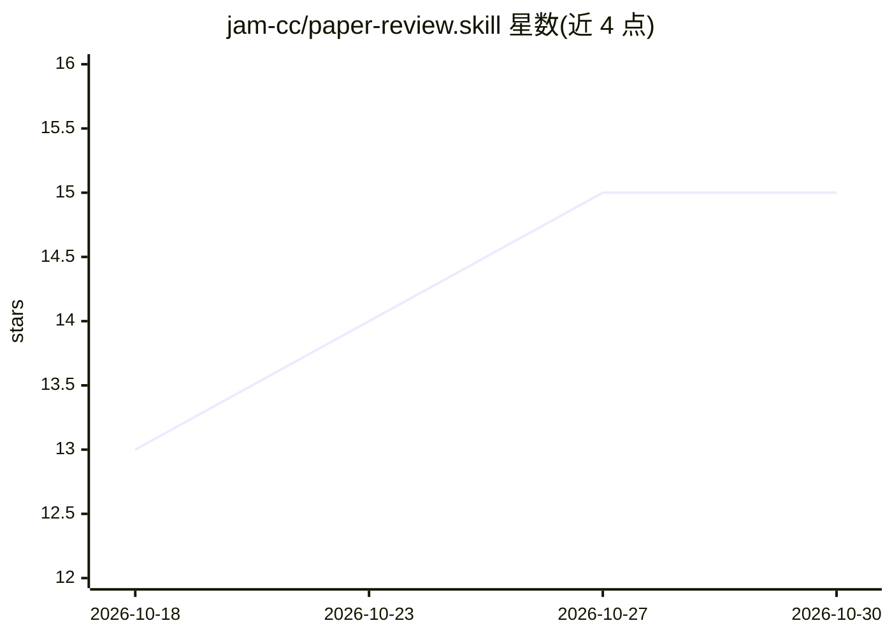

# jam-cc/paper-review.skill

⭐ 15 · MIT · 推送 2026-09-10 · [GitHub](https://github.com/jam-cc/paper-review.skill) · 个人维护 · 中文 README

**供 AI 助手执行的研究论文审稿 skill：生成有据可查的审稿意见**

一个以 SKILL.md 为入口、面向 ML/AI 会议论文审稿的 Agent Skill：把四阶段流程（查相关工作→核对贡献与证据→写审稿意见→精简核验引用）写成指令，供 Codex、Claude Code、Gemini CLI 及其他能读 Markdown 的助手执行，输出可追溯的审稿草稿（含 Summary/Strengths/Weaknesses/Questions），供投稿前自审、组内讨论、rebuttal 准备与辅助同行评审。不绑定模型、无需专用 SDK；批评须对应论文内容或外部来源，查不到的引用不进参考文献。

## 筛选速览

| 维度 | 判定 | 备注 |
|---|---|---|
| AI 角色 | `ai-native` | 本体是模型或模型工具 |
| 许可风险 | `permissive` | MIT |
| 部署形态 | `None` |  |
| 模型依赖 | — | README 未给出锁定关系 |
| 硬件要求 | — | 无带数字的原话,不猜 |
| 安装摩擦 | `low` | 无编译、无系统依赖或容器化 |
| 成熟度 | — | 结构信号不足 |

## 能力要点

- 四阶段审稿流程：相关工作→贡献核对→意见撰写→引用核验
- 适配 Codex / Claude Code / Gemini CLI，也支持任意能读 Markdown 的助手
- 每条关键批评须可追溯到论文内容或外部来源，引用默认最多 4 条
- 支持中英文请求与输出，可导出到 outputs/ 目录（txt/docx/frontier 笔记）

## 适用场景

- 投稿前自审：检查贡献表述、baseline 公平性与消融实验
- 组内讨论时把“感觉有问题”落实到具体表格与实验设置
- 准备 rebuttal 时区分需澄清、需补证、应收窄的主张
- 在审稿规范允许时整理有依据的评审草稿并人工核查

## 场景标签

`科研工具` · 领域:学习与行业

## 证据(README 行号)

> L3: > 这个 skill 能直接生成**专业、有理有据的审稿意见**，经过专业研究人员长期使用和持续改进。
> L5: 适用于 **Codex、Claude Code、Gemini CLI**，也可以把指令和材料交给其他 AI 助手使用。
> L98: 把 SKILL.md、其中需要的 `references/` 文件和论文提供给助手，要求按此流程审阅。能读 Markdown 的助手可以使用这些指令；自动发现 skill、联网核验和文件导出取决于宿主能力。**本项目无需专用 SD

## 星数曲线

2026-10-18 13 → 2026-10-30 15（+2）

---
*卡片 v1 · prompt 1.4 · 生成 2026-10-30 · 置信度 high · 依据 README sha `0a5c57fab87c` · [字段定义](../../DATASET.md)*
