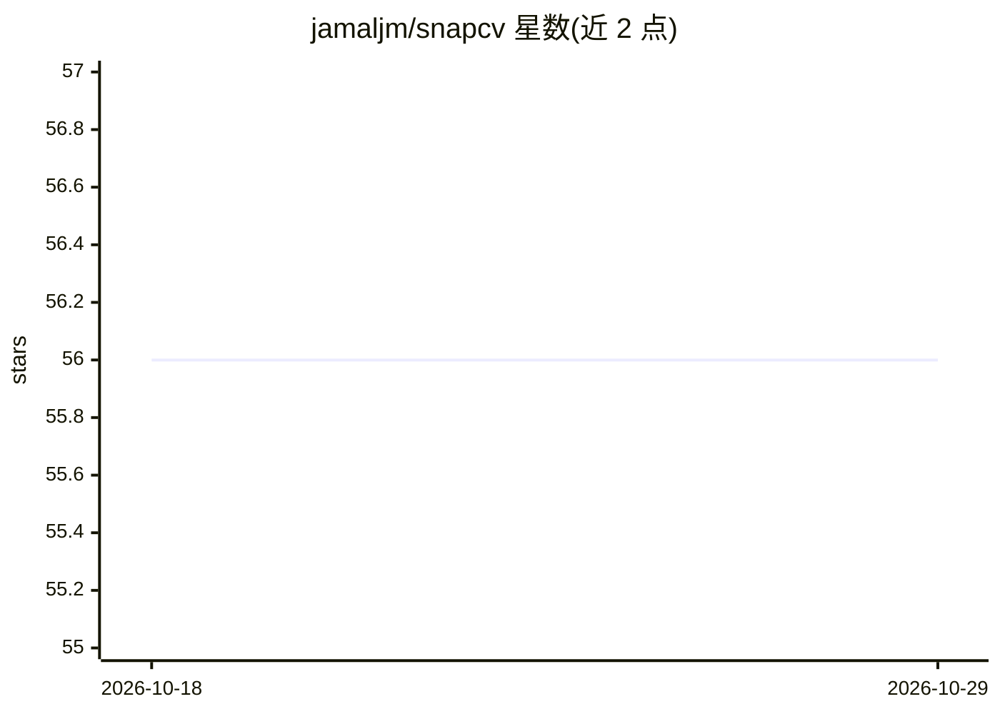

# jamaljm/snapcv

⭐ 56 · TypeScript · AGPL-3.0 · 推送 2026-07-11 · [GitHub](https://github.com/jamaljm/snapcv) · [官网](https://snapcv.me) · 个人维护

**上传简历自动生成个人作品集网站的 AI 工具**

面向求职者与开发者的开源作品集生成器：上传简历 PDF 或粘贴 LinkedIn URL，后端用 OpenAI 将简历解析为结构化 JSON，生成托管在 name.snapcv.me 子域的作品集页面与简历页。支持 Google 登录、GitHub Wrapped、技能拖拽排序与主题切换。技术栈为 Next.js + Tailwind + Supabase（认证/数据库/存储），后端为 Node/Express。自部署需 Node.js >=20、Supabase 项目与 OpenAI API key，许可为 AGPL-3.0。

## 筛选速览

| 维度 | 判定 | 备注 |
|---|---|---|
| AI 角色 | `ai-native` | 本体是模型或模型工具 |
| 许可风险 | `viral` | AGPL-3.0 |
| 部署形态 | `library` | 以包/库形式分发 |
| 模型依赖 | — | README 未给出锁定关系 |
| 硬件要求 | — | 无带数字的原话,不猜 |
| 安装摩擦 | `low` | 无编译、无系统依赖或容器化 |
| 成熟度 | — | 结构信号不足 |

## 能力要点

- 上传简历 PDF 或 LinkedIn URL，AI 后端解析为结构化 JSON 生成作品集
- 每个作品集托管于 name.snapcv.me 自定义子域
- 简历页 + 作品集双视图、GitHub Wrapped、技能拖拽排序与主题
- Supabase 认证/存储 + Node/Express 后端，源码可自部署

## 适用场景

- 把简历快速变成可分享的个人作品集网站
- 从已关停的 read.cv / Bento 迁移个人主页
- 自部署并自定义属于自己的作品集站点

## 场景标签

`文档解析` · 领域:知识与检索

## 证据(README 行号)

> L14: Upload a résumé (or paste a LinkedIn URL) → an AI backend structures it → you get
> L25: - **AI-driven portfolio creation**: upload a résumé PDF, get a polished portfolio.
> L33: - **Backend:** Node.js + Express, OpenAI (résumé → structured JSON), `pdf-parse`

## 星数曲线

2026-10-18 56 → 2026-10-29 56（+0）

---
*卡片 v1 · prompt 1.4 · 生成 2026-10-24 · 置信度 high · 依据 README sha `2ef8d6d63cef` · [字段定义](../../DATASET.md)*
