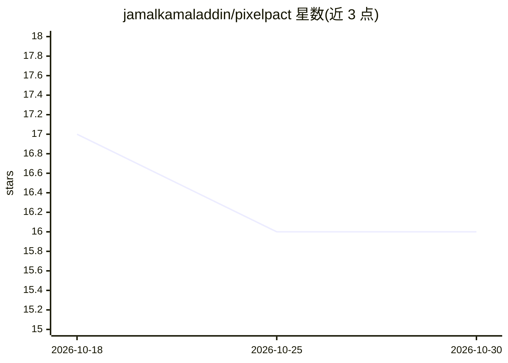

# jamalkamaladdin/pixelpact

⭐ 16 · TypeScript · MIT · 推送 2026-10-17 · [GitHub](https://github.com/jamalkamaladdin/pixelpact) · [官网](https://pixelpact.dev) · 个人维护

**给编码 agent 的 UI 实现测量工具：对照参考页输出数值偏差**

CLI 与 MCP 服务器组合：用 Playwright 打开参考页，提取每个可见元素的计算样式、几何尺寸、设计 token、hover/focus 状态与动画关键帧，存为可提交的纯 JSON 契约文件；再对实现页逐属性比对，输出期望值、实测值与差值列表及像素差异百分比。面向让编码 agent 闭环自查 UI 实现的开发者，提供 pixelpact-mcp（4 个工具）、GitHub Action PR 评论、Figma frame 读取（REST API，data-contract 属性绑定）与 side/diff 命令。要求 Node 22.12+，Playwright 为 peer dependency，框架无关。

## 筛选速览

| 维度 | 判定 | 备注 |
|---|---|---|
| AI 角色 | `ai-ecosystem` | LLM/agent 周边工具 |
| 许可风险 | `permissive` | MIT |
| 部署形态 | `library` | 以包/库形式分发 |
| 模型依赖 | — | README 未给出锁定关系 |
| 硬件要求 | — | 无带数字的原话,不猜 |
| 安装摩擦 | `low` | 无编译、无系统依赖或容器化 |
| 成熟度 | — | 结构信号不足 |

## 能力要点

- 从参考页提取 JSON 契约（样式/几何/token/hover/focus/keyframes）
- 逐属性偏差报告：期望值、实测值与差值，退出码 0/1 可入 CI
- MCP 服务器暴露 extract_contract/check_implementation/diff_pixels/read_contract_summary 供 agent 自查
- 支持 Figma frame 作为参考源与分节 side-by-side 对比

## 适用场景

- 让编码 agent 写完 UI 后自行对照设计参考核对并修复
- 在 PR 中用 CI 检查实现页与参考契约的数值偏差
- 把 Figma frame 转成可提交、可 review 的设计契约文件

## 场景标签

 · 领域:前端开发工具/UI 测试

## 证据(README 行号)

> L38: An agent that writes UI code cannot tell whether it succeeded. `pixelpact-mcp` gives it the
> L51: Tools exposed: `extract_contract`, `check_implementation`, `diff_pixels`,

## 星数曲线

2026-10-18 17 → 2026-10-30 16（-1）

---
*卡片 v1 · prompt 1.4 · 生成 2026-10-30 · 置信度 high · 依据 README sha `f8d9a9fdf1b9` · [字段定义](../../DATASET.md)*
