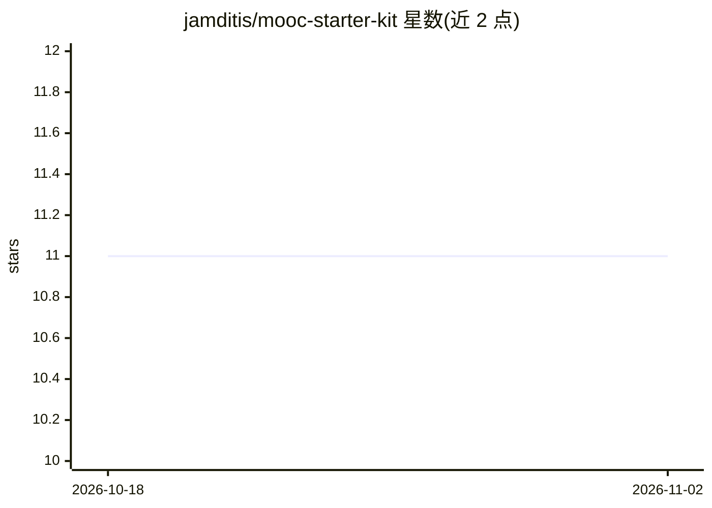

# jamditis/mooc-starter-kit

⭐ 11 · Python · NOASSERTION · 推送 2026-09-14 · [GitHub](https://github.com/jamditis/mooc-starter-kit) · [官网](https://mooc.amditis.tech/starter-kit/) · 组织维护

**记者 AI 编程工具课程的起始工作区仓库（MOOC 配套）**

Knight Center MOOC《记者高级提示工程》的起始仓库：供学员 Fork 后作为四个课程模块的工作区，内含 CLAUDE.md 上下文文件脚手架、MEMORY/LESSONS 文件、Claude Code skills、slash commands、hooks、插件骨架、流水线脚本、GitHub Actions 工作流与示例新闻文档。需自备 Node.js 20+ 并安装一个 AI CLI 工具（Claude Code / Gemini CLI / Codex CLI 三选一）。课程材料以 CC BY 4.0 授权，作者来自 Montclair State University 合作媒体中心。

## 筛选速览

| 维度 | 判定 | 备注 |
|---|---|---|
| AI 角色 | `ai-knowledge` | 知识聚合/清单类 |
| 许可风险 | `none` | NOASSERTION |
| 部署形态 | `library` | 以包/库形式分发 |
| 模型依赖 | — | README 未给出锁定关系 |
| 硬件要求 | — | 无带数字的原话,不猜 |
| 安装摩擦 | `low` | 无编译、无系统依赖或容器化 |
| 成熟度 | — | 结构信号不足 |

## 能力要点

- 提供覆盖四个模块的完整文件脚手架（上下文文件、skills、commands、hooks、插件、流水线脚本）
- 兼容 Claude Code / Gemini CLI / Codex CLI 三种工具（含 AGENTS.md、GEMINI.md 存根）
- 含文件到视频的索引（docs/module-map.md）与模块对照表
- 课程材料以 CC BY 4.0 授权

## 适用场景

- 跟随课程逐步搭建自己的 AI 辅助新闻工具箱
- 学习 AI CLI 工具的 skills、hooks、插件与流水线模式
- 在特定报道领域（beat）上完成课程最终项目

## 场景标签

`提示工程` `教程课程` · 领域:Agent 开发

## 证据(README 行号)

> L5: A starter repo for the Knight Center MOOC on using AI coding tools from the command line. Fork this repo, clone your
> L17: Your workspace for all four modules. By the end of the course, it'll be a working AI-assisted journalism toolkit yo

## 星数曲线

2026-10-18 11 → 2026-11-02 11（+0）

---
*卡片 v1 · prompt 1.4 · 生成 2026-11-02 · 置信度 mid · 依据 README sha `c25c73045e10` · [字段定义](../../DATASET.md)*
